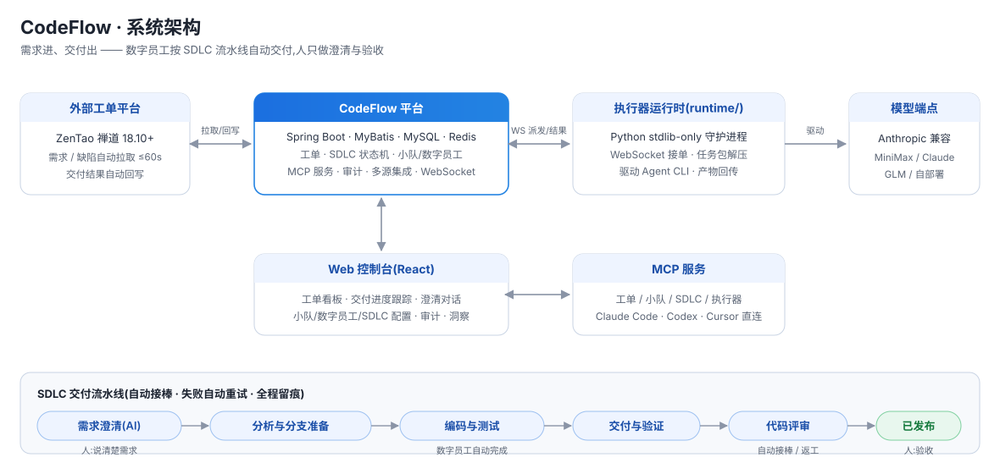
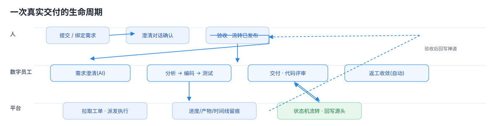
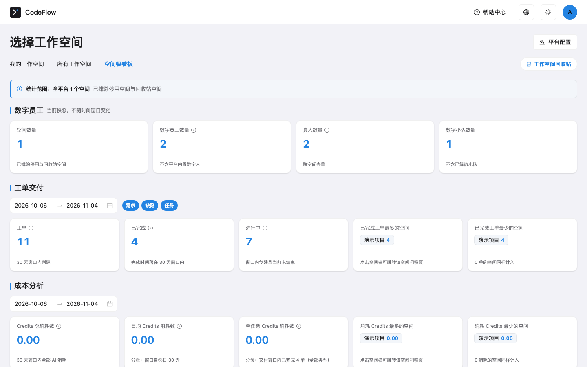
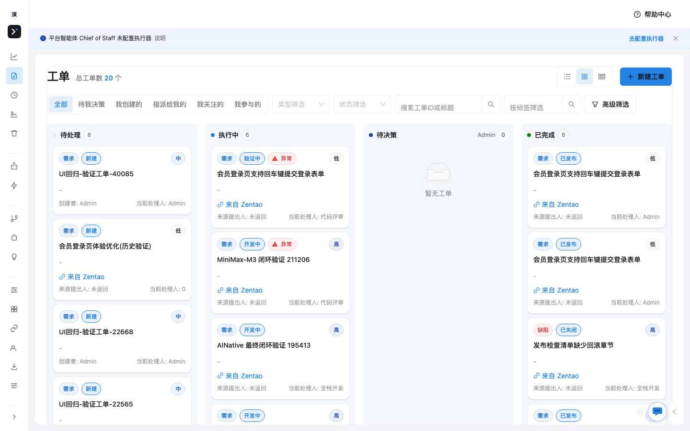
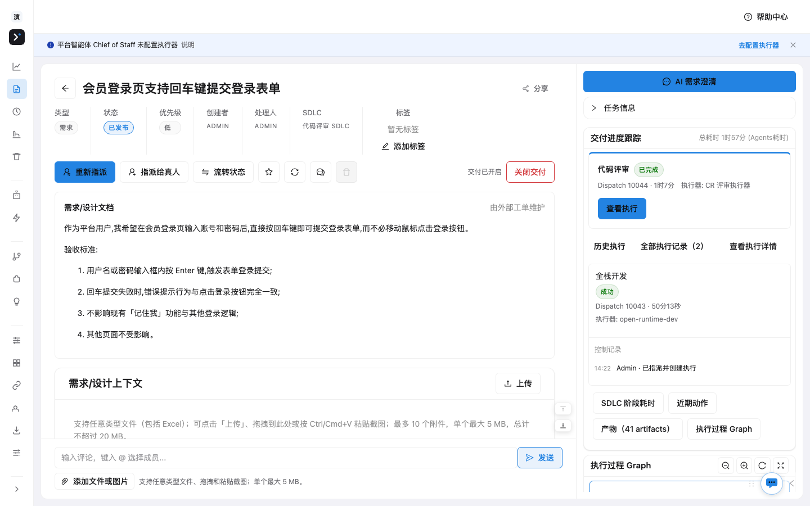

<div align="center">

# CodeFlow

### 需求进,交付出。

**AI 数字员工小队按 SDLC 流水线自动交付软件——你只负责说清楚需求,和验收成果。**

[](platform/ainative/LICENSE)
[](LICENSE)
[](platform/ainative)
[](platform/ainative/frontend)
[](runtime/)
[](#-测试)

[快速开始](#-快速开始) · [架构](#-架构) · [禅道闭环](#-禅道闭环已真实验证) · [文档](#-文档)

</div>

---

## 为什么是 CodeFlow?

直接用 Claude Code 写代码很爽,但**交付一个需求 ≠ 写一段代码**:

- 需求散落在禅道/Jira 里,Agent 看不到;
- 分析、编码、测试、评审各有最佳时机,单会话一次跑不完;
- 多角色(开发、评审)需要接棒,失败需要重试,过程需要留痕;
- 交付完,结果还要回到工单平台闭环。

CodeFlow 把这些**工程化环节**做成平台:数字员工小队按可编排的 SDLC 流水线自动完成分析、编码、测试与代码评审,多角色自动接棒、失败自动重试;人只在两个点上介入——**需求澄清**与**最终验收**。你的 Agent CLI(Claude Code / Codex / Cursor)依旧是执行者,CodeFlow 是它们的**交付调度台**。

<div align="center">

</div>

## ✨ 核心特性

| | 特性 | 说明 |
|---|---|---|
| 🔁 | **外部工单闭环** | 禅道 ZenTao 18.10+ 需求/缺陷 ≤60 秒自动拉取入库,交付备注与缺陷 resolved 状态自动回写源头。已真实验证全闭环 |
| 🧩 | **SDLC 流水线可编排** | 步骤、完成门、产物要求、角色接棒全部可配置;内置「开发 + 代码评审」模板,评审不通过自动返工收敛;支持 AI 对话生成新流程 |
| 🤖 | **数字员工小队** | 每个数字员工有独立角色设定、系统提示词、技能与仓库权限;小队多角色自动接棒,失败按 attempt 递增重试,全程留痕 |
| 🔌 | **执行器与平台解耦** | 数字员工由你自己机器上的执行器运行时驱动(Python 标准库零三方依赖);模型端点自选——MiniMax / Claude / GLM / 自部署 |
| 🛠 | **MCP 全能力开放** | 工单、小队、SDLC、执行器、仓库、记忆全部以 MCP 工具暴露——Claude Code / Codex CLI / Cursor 可直接操作平台 |
| 🖥 | **结构化交付留痕** | 工单快照、步骤时间线、执行日志、产物清单、评审 findings 全部落库;回收站、审计、洞察、备份齐备 |

<div align="center">

</div>

<details>
<summary><b>📷 平台界面预览</b>(点击展开)</summary>

| 交付大盘 | 工单看板 |
|---|---|
|  |  |

| 交付进度跟踪(数字员工执行中) | |
|---|---|
|  | 更多 32 张实机截图见 [docs/user-guide.md](docs/user-guide.md) |

</details>

## 🚀 快速开始

> **前置**:Docker;其余构建工具均在容器内。执行器需要 Python 3.11+。

### ① 启动平台(约 3 分钟)

```bash
git clone https://github.com/qsumm/CodeFlow.git && cd CodeFlow/platform
cp runtime.env.example runtime.env      # 密码默认可跑通本机/内网;公网部署先全部替换
docker compose --env-file runtime.env up -d mysql redis minio
docker compose exec -T mysql mysql -uainative -pchange-me ainative < docs/ainative-schema.sql   # 首次必做:导入全量建表
bash build.sh                            # 复用随库 dist 构建,无需本地 Node/JDK(跳过测试编译)
docker run -d --name codeflow --network ainative-community \
  --env-file runtime.env -p 7001:7001 codeflow:local
# 可选:导入预置小队模板(全链路研发协作等 7 个)
# docker compose exec -T mysql mysql -uainative -pchange-me ainative < docs/ainative-community-templates.sql
```

打开 **http://localhost:7001** — 注册的第一个账号即平台管理员。

> **低配机器(≤2G 内存)注意**:源码构建(mvn 编译 1286 个源文件)至少需要
> **2G 内存 + 2G swap**,否则会触发系统 OOM(实测 1.8G ECS 连同机 MySQL 一起被杀)。
> 内存不足时:① 加 swap:`fallocate -l 4G /swapfile2 && mkswap /swapfile2 && swapon /swapfile2`;
> ② 或在 4G+ 机器上构建后 `docker save | load` 导入低配机运行。

<details>
<summary>compose 网络说明</summary>

compose 会自动创建网络 `ainative-community`,应用容器需加入同一网络。
若用 `docker compose up -d` 全量启动(含应用),则无需手动建网。

</details>

### ② 跑起执行器(必做,全程界面操作)

数字员工由执行器驱动——没有它,派发会停在「等待执行器上线」:

1. 平台「执行器」页 → **新建执行器**(表单即完成,平台签发 Token);
2. 打开该执行器的 **「启动命令」**——平台把 Token、地址、参数全部生成好,**一键复制**;
3. 粘贴到目标机器终端执行,守护进程自动连上平台,状态变 **ONLINE**。

> 不需要手动配置环境变量。首次登录还有 4 步引导页带你走完整个流程。

### ③ 交付第一条需求

平台新建工单 → AI 需求澄清 → 启动交付 → 在「交付进度跟踪」看数字员工干活 → 验收发布。
完整图文说明见 **[docs/user-guide.md](docs/user-guide.md)**(32 张实机截图)。

## 🏗 架构

```
platform/    平台:服务端(Spring Boot + MyBatis + MySQL)+ 前端(React,随库 dist)
runtime/     执行器运行时:WebSocket 接单、任务包解压、驱动 Agent CLI、产物回传
tests/       执行器运行时测试(pytest)
scripts/     执行器注册、存储桶创建、禅道 E2E 验证
docs/        用户手册、集成指南、SDLC 设计、发布清单、平台协议文档
```

设计要点:

- **协议先行** — WebSocket 帧协议(心跳/派发/结果/重连)、任务包 schema(`ainative.taskPackage.v1`)、MCP 工具契约均有文档(`platform/ainative/docs/`)
- **可靠投递** — outbox 先落库后发送、幂等键唯一约束、断线重连、attempt 递增恢复
- **产物面门禁** — 预构建 dist 随库分发,关键特性带产物指纹测试,防止「源码有、产物无」
- **缺陷管理纪律** — 所有缺陷一律登记,根因写到「为什么写错」的层面,禁止修完不回归

## 🔗 禅道闭环(已真实验证)

建需求 → ≤60s 自动拉取 → AI 澄清 → 派发交付 → 交付备注回写 → 建缺陷 → 指派修复 → 回写 `resolved`。

绑定与验证方式见 [docs/zentao-integration.md](docs/zentao-integration.md),配套 E2E 脚本在 [scripts/](scripts/)。

## 🧪 测试

```bash
# 执行器运行时(pytest,标准库零依赖)
python -m pytest tests/ -q

# 平台后端(容器内 Maven)
docker run --rm -v "$PWD/platform/ainative":/workspace -w /workspace \
  maven:3.9.9-eclipse-temurin-21 mvn -B -ntp test

# 平台前端(vitest)
cd platform/ainative/frontend && npm ci && npm run test:run
```

当前基线:后端 **7612** / 前端 **3745** / 运行时 **51** 用例全绿。

## 📚 文档

| 文档 | 内容 |
|---|---|
| [docs/user-guide.md](docs/user-guide.md) | 用户操作手册 — 32 张实机截图,覆盖全部 28 个页面 |
| [docs/zentao-integration.md](docs/zentao-integration.md) | 禅道绑定、拉取/回写语义、E2E 验证 |
| [docs/sdlc-driver-design.md](docs/sdlc-driver-design.md) | SDLC 驱动器实现设计 |
| [docs/release-checklist.md](docs/release-checklist.md) | 发布检查清单 |
| [platform/ainative/docs/](platform/ainative/docs/) | 平台协议、部署、运维、恢复、MCP 文档 |

## 🤝 参与

欢迎 Issue 与 PR。

- 平台侧:改动后请跑通对应测试与 `npm run check:i18n`(前端多语言门禁)
- 执行器侧:保持 stdlib-only(零三方运行时依赖)
- 缺陷一律登记,根因写到「为什么写错」的层面,禁止修完不回归

## 📄 许可证

| 模块 | 许可证 |
|---|---|
| [platform/](platform/) 平台源码 | 上游 **MIT**([platform/ainative/LICENSE](platform/ainative/LICENSE)) |
| [runtime/](runtime/) · [scripts/](scripts/) · [tests/](tests/) | **Apache-2.0** |

---

## License / 许可证

本项目以 **Apache License 2.0** 开源,详见 [LICENSE](LICENSE) 与 [NOTICE](NOTICE)。
Copyright 2026 The CodeFlow Authors.
