# 19 · 用户操作手册

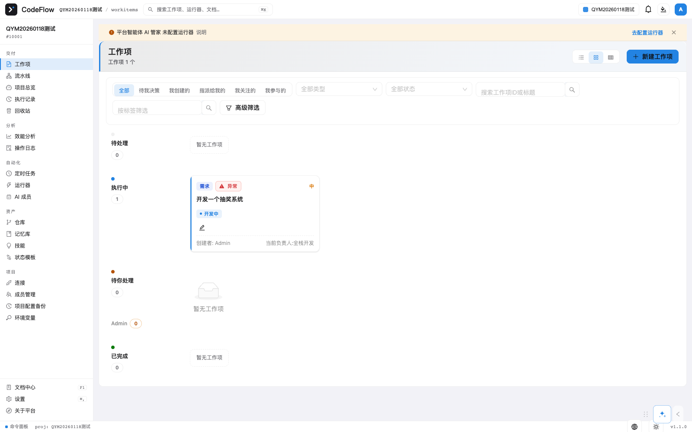

> 版本:v1.2.0(2026-11-12,与平台版本对齐) · 适用平台:CodeFlow 1.2.0
> 适用读者:使用平台的研发 / 产品 / 测试同学,以及负责接入禅道与运行器的管理员
> 配图:共 49 张,全部取自实机截图(明色主题,除注明外)
> v1.3 增补:关于平台改版「交付 9 号线」地铁图;项目总览 KPI 八卡同构统一;
> 通知渠道飞书选中态(通知设置 IM 列随平台选中渠道切换)
> v1.2 要点:登录页 TestOPS editorial 背景 + 价值链动效;全站墨色横幅设计系统;
> 左树导航图标按语义动效;主题工作台(换色/自定义背景);运行器启动命令三模式;
> 平台智能体更名「AI 管家」;全站 34px 控件对齐

**这本手册解决什么**:需求写了三页、开发理解偏十里;排期等一周、写码只要一天;进度全靠问、交付全靠催;换个人接手、上下文全丢——这些交付痛点,就是 CodeFlow 的用武之地。你把需求说清楚(AI 澄清会帮你问对问题),分析、编码、测试、验证、评审、部署由 AI 成员按流水线自动完成,全程留痕、产物归档,人只做澄清与验收。下面按你的实际动线讲清每一步。

---

## 目录

1. [登录与界面结构](#1-登录与界面结构)
2. [工作空间](#2-工作空间)
3. [空间级看板](#5-空间级看板)
4. [工作项:从需求到交付的主线](#4-工作项从需求到交付的主线)
5. [AI 需求澄清对话](#5-ai-需求澄清对话)
6. [交付进度跟踪:看AI 成员干活](#6-交付进度跟踪看AI 成员干活)
7. [AI 成员与小队](#7-AI 成员与小队)
8. [流水线(流程模板)](#8-流水线流程模板)
9. [运行器管理](#9-运行器管理)
10. [仓库与技能](#10-仓库与技能)
11. [外部连接:禅道闭环](#11-外部连接禅道闭环)
12. [消息渠道(钉钉/飞书)](#12-消息渠道钉钉飞书)
13. [个人设置与 MCP 令牌](#13-个人设置与-mcp-令牌)
14. [平台级配置](#14-平台级配置)
15. [洞察、定时任务与审计](#15-洞察定时任务与审计)
16. [文档中心](#16-文档中心)
17. [日常怎么用:推荐工作流](#17-日常怎么用推荐工作流)
18. [常见问题](#18-常见问题)
19. [修订记录](#19-修订记录)

---

## 1. 登录与界面结构

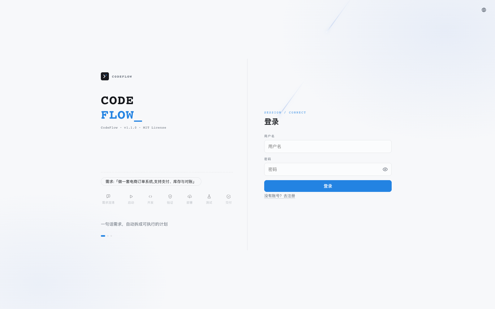

图1　登录页(左:品牌与价值区「光点推进链」;右:登录表单)

- 首次部署通过 `http://<平台地址>:7001/register` 注册首个用户,**建组织即成为管理员**;之后所有成员从登录页进入。
- 登录页背景为 TestOPS editorial 风格:纸底 + 双光晕 + 流星层;左侧展示平台价值——
  九段生命周期「光点推进链」(需求澄清 → 启动 → 开发 → 验证 → 部署 → 测试 → 交付),
  光点走过一段点亮一段,配合轮播的价值主张;右侧为登录表单。
- 登录页固定亮色,不随主题变化;语言跟随浏览器,可在登录后右上角切换。

登录后的整体布局:

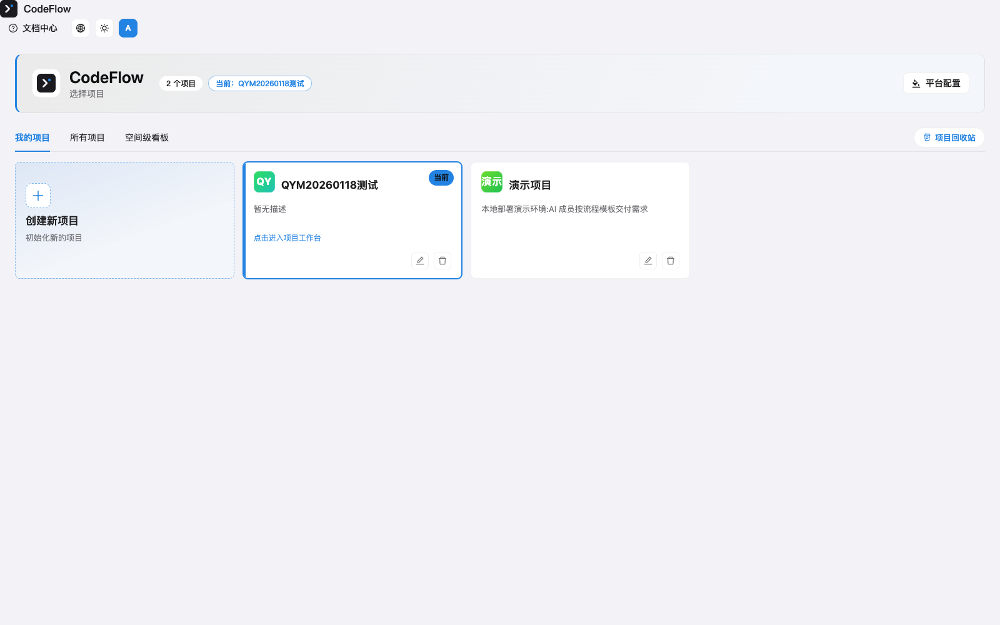

图2　工作空间选择页(登录后第一站)

| 区域 | 说明 |
|---|---|
| 顶栏 | 品牌 → 当前项目 / 路径(如 `演示项目 / workitems`)→ ⌘K 命令面板 → 项目切换 → 通知 → **主题工作台** → 用户菜单 |
| 左侧导航树 | 按「交付 → 分析 → 自动化 → 资产 → 项目」分组的树状导航;每个图标按自身语义有专属动效(悬浮眨两下、选中敲一下) |
| 内容区 | 各功能页;列表类页面为「墨色横幅 + 速览徽章 + 工具栏 + 内容面板」的统一骨架 |
| 底部状态栏 | 命令面板入口 / 当前项目 / 语言切换 / 明暗外观切换 / 平台版本 |

### 1.1 主题工作台(右上角 🎨)

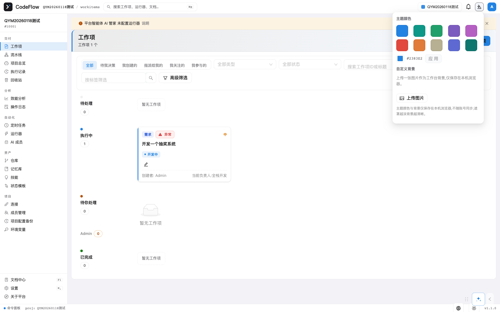

图32　主题工作台(预设色板 + 自定义色 + 自定义背景)

- **主题颜色**:10 个精选预设(溪蓝/黛青/苔绿/鸢尾紫/朱砂/琥珀/沙金/靛蓝/松绿),或用取色器自定义;「跟随平台」恢复品牌色。切换即时生效,链接/高亮/选中态/图表全部跟随;
- **自定义背景**:上传本地图片作为工作台壁纸(前端自动压缩,超 1.2MB 拒绝),「背景遮罩」滑杆实时调节清晰度与可读性;仅保存在本机浏览器,不随账号漫游;
- 明暗模式(☀/🌙/🖥)在旁边的「切换外观」按钮,与主题色独立组合。

## 4. 首次使用引导

第一次登录并选择工作空间后,系统自动进入 4 步引导页(`/onboarding`,可随时跳过,也能从「关于平台」页重放):

| 步 | 内容 | 要点 |
|---|---|---|
| 1 认识模型 | 「需求进 · 交付出」的流水线示意 | 记住关键认知:AI 成员由你部署的**运行器**驱动,不在浏览器里 |
| 2 跑起运行器(必做) | 可复制的启动代码块 + 实时探测 | 在「运行器」页注册拿到 ID/Token → 机器上配 env → 启动 daemon;本页每 3 秒自动探测,**状态变绿即可继续** |
| 3 认识预置阵容 | 开发与评审小队、两个AI 成员、两套 流水线模板 | 开箱可用;自定义小队 / AI 生成流程 / 登记仓库为可选 |
| 4 打通需求源 | 禅道绑定三要素 + 测试连接 | 可选:跳过也能直接「新建工作项」体验交付 |

- 引导状态保存在浏览器本地;换浏览器或清除存储后会再次出现,点「完成」即不再提示。
- 未配置运行器时点「跳过引导」会二次确认(防止新手漏掉关键一步)。

## 4. 记忆外挂(可选 · PowerContext)

平台可选接入 [PowerContext](https://github.com/oceanbase/powercontext)(Apache 2.0 的 AI Agent 上下文服务),为AI 成员提供**跨工作项记忆**:dispatch 开工前自动注入历史决策/约束,交付后写回本次关键结论。不配置即完全关闭,零影响。

**配置**(运行器 runtime 的 env,见 `.env` 模板):

| 变量 | 说明 |
|---|---|
| `POWERCONTEXT_BASE_URL` | PowerContext Server 地址(如 `http://127.0.0.1:8077`);不配 = 关闭 |
| `POWERCONTEXT_TIMEOUT_SEC` | HTTP 超时,默认 8s |
| `POWERCONTEXT_REMEMBER` | 是否写回(默认 1) |

**工作方式**:CodeFlow 工作空间 ID ↔ PowerContext Scope 一次性绑定(`bind_workspace`)后,每次派发:①`/v1/context/prepare` 有界召回 → 写入交付目录 `powercontext-context.md` 随 prompt 注入(内容自带「资料非指令」信任边界声明);②交付成功后摘要写回 Memory(幂等键=dispatch ID)。**所有失败静默降级,绝不阻断交付**。

## 4. 工作空间

- 登录后先选**工作空间**;工作项、小队、流水线、运行器、连接等所有业务数据都归属某个工作空间。
- 管理员可在「成员」页邀请新成员并分配角色;一个用户可属于多个工作空间,顶部标签页可随时切换(我的工作空间 / 所有工作空间)。
- 「空间级看板」提供跨页面的汇总视角(AI 成员数、工作项交付量、Credits 消耗分析):

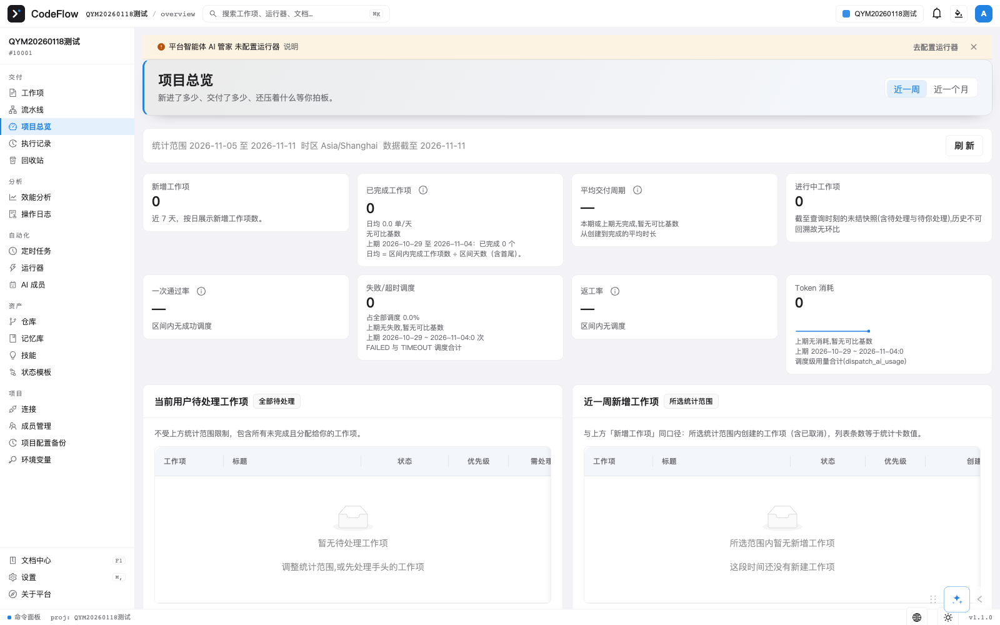

图4　空间级看板(交付量与成本消耗汇总)

⚠ 工作空间删除会级联影响其下工作项与配置,属高危操作,请先在「回收站/备份」确认后再执行。

---

## 5. 空间级看板

入口:左侧导航 → 看板(`/#/workspaces/dashboard`)。

大盘回答三个问题:**现在有多少活、干到哪了、谁在干**。工作项按状态分列(待处理 / 执行中 / 待决策 / 已完成),异常派发直接在卡片上标红。

日常读法:

1. 先看「执行中」列有没有 `异常` 红标——那是需要人工介入的派发;
2. 再看「待决策」列——那是等你拍板的工作项(澄清回复、验收);
3. 「已完成」列看今天交付了什么。

---

## 6. 工作项:从需求到交付的主线

> 产品内统一叫「工作项」;一个工作项 = 一件要交付的事,从需求澄清一路走到发布。

### 4.1 工作项列表

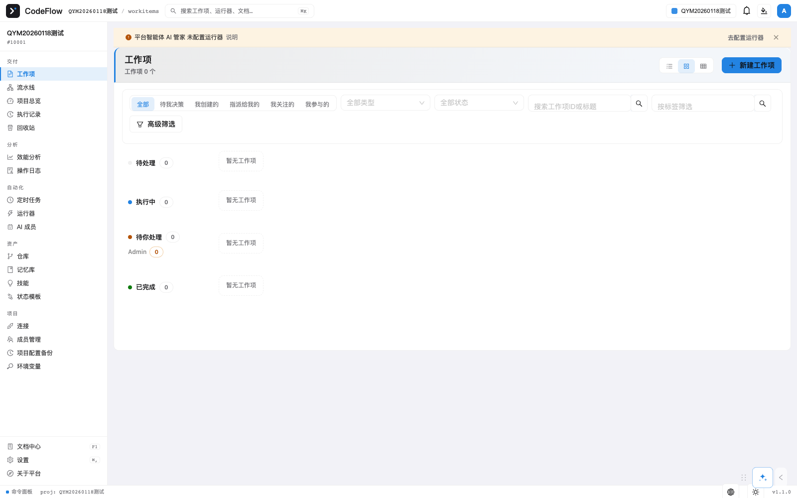

图5　工作项看板(状态分列卡片式)

| 元素 | 说明 |
|---|---|
| 范围页签 | 全部 / 待我决策 / 我创建的 / 指派给我的 / 我关注的 / 我参与的 |
| 类型/状态筛选 | 按工作项类型(需求/缺陷)与状态节点过滤 |
| 搜索框 | 按工作项 ID 或标题搜索 |
| 标签筛选 / 高级筛选 | 组合条件;高级筛选支持优先级、创建者等更多维度 |
| 卡片 | 类型、状态、优先级、标题、创建者、当前处理人;**外部来源工作项带「来自 ZenTao」链接**,点击直达禅道原始对象 |
| 视图切换 | 看板 / 列表 / 表格三种视图 |

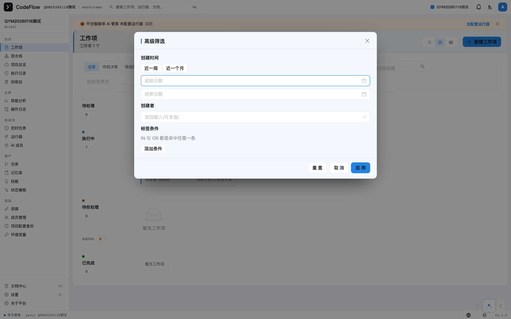

图6　工作项高级筛选

### 4.2 新建工作项

入口:工作项页右上角「+ 新建工作项」。

必填:**类型**(需求/缺陷)、**标题**、**需求/设计文档**(Markdown);可选:优先级。
创建后进入工作项详情页。工作项支持上传需求/设计上下文附件(任意类型,单个 5MB、总共 20MB,可粘贴截图)。

### 4.3 工作项详情


图7　工作项详情(新建工作项)

| 元素 | 说明 |
|---|---|
| 元信息条 | 类型 / 状态 / 优先级 / 创建者 / 处理人 / 标签,状态与标签可直接改 |
| 启动交付 | 指派AI 成员并按流水线 启动自动交付(见 §4.4) |
| 指派真人 / 流转状态 | 人工接棒与状态流转 |
| 需求/设计文档 | Markdown 编辑;外部来源工作项只读并显示「由外部工作项维护」 |
| 评论 & 时间线 | 全部沟通与系统事件(创建/流转/派发/交接/回写)按时间倒序 |
| 右栏 | AI 需求澄清(§5)、任务信息、交付进度跟踪(§6) |
| 分享 | 生成只读分享链接(产物页无需登录可看) |

外部来源工作项(禅道拉取)在标题下显示来源标识,删除受保护——**必须回禅道处理,平台侧不可删**。

下面是一个真实交付中的工作项:左侧是需求正文(由外部工作项维护,只读),右栏是实时交付进度:


图8　真实交付中的工作项(外部来源 + 右栏实时交付面板)

发评论的即时反馈(左下角「评论已发送」提示):

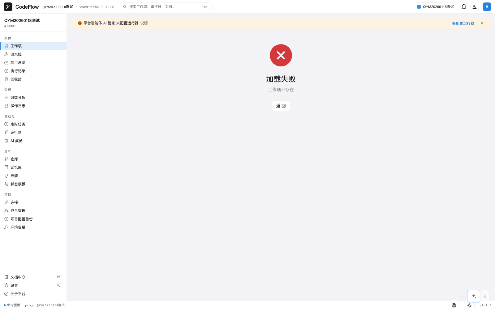

图9　发表评论成功

### 4.4 启动交付(把活交给AI 成员)

1. 点「启动交付」→ 右栏进入「AI 需求澄清」向导,选择小队与AI 成员;
2. 确认后平台创建派发(dispatch),工作项进入「执行中」;
3. 运行器在线时立即开始跑流水线;离线则排队等待并显示原因(§6)。

交付开启后,工作项右上出现「关闭交付」;关闭后不再接受新的自动派发,评论区 @ AI 成员也会被拦截提示。

### 4.5 删除与回收站

删除工作项进入回收站(左侧导航垃圾桶图标),可恢复;外部来源工作项不可删除。

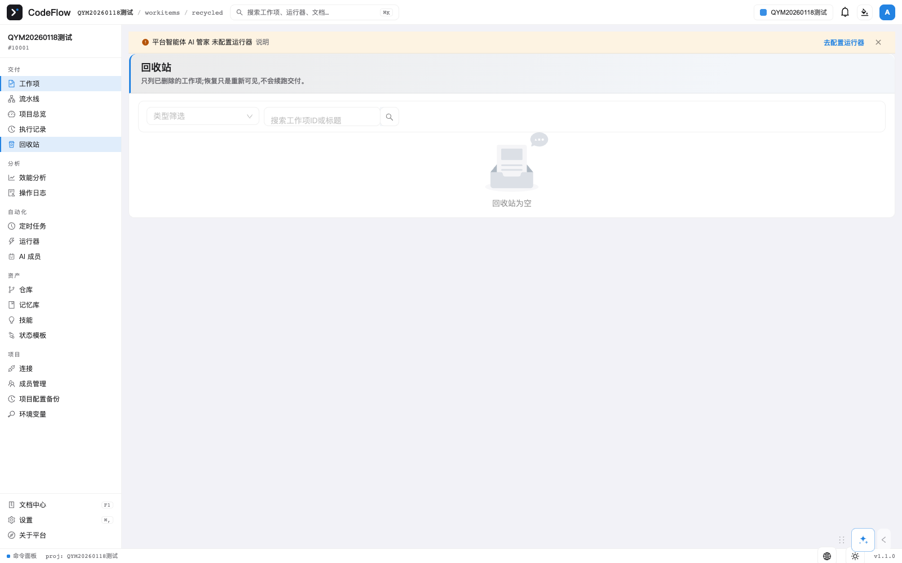

图10　工作项回收站

---

## 7. AI 需求澄清对话


图11　工作项详情右栏的 AI 需求澄清向导

- **启动交付前**:右栏「AI 需求澄清」进入向导,按小队 → AI 成员两级选择交付主体;
- **交付中**:直接在评论区 `@AI 成员` 提问,AI 成员经平台 MCP **实时读取工作项内容**后作答与追问,形成澄清会话;
- AI 成员的每次回复都带用量(模型/Token)与耗时,可在时间线追溯。

**发送方式可切换**:输入框旁的入口标明当前模式——默认 Shift+回车 发送(回车换行),可切为回车发送;切换会写入个人偏好,重新登录后保持。回复进行中输入框会禁用并显示动态指示,可随时「终止响应」;每条回复都带用量与耗时。

⚠ 需求描述写不清是交付返工的最大来源。建议启动交付前先用澄清对话把验收标准对齐——这比事后返工便宜得多。

---

## 8. 交付进度跟踪:看AI 成员干活


图12　交付进度跟踪面板(当前派发 + 历史执行)

| 元素 | 说明 |
|---|---|
| 当前派发卡 | AI 成员 / 流水线步骤 / 状态(含 失败 红标)/ Dispatch ID / 耗时 / 运行器名 |
| 查看执行 | 打开该派发的实时执行视图(终端/日志) |
| 重试 | 失败后原样重发 |
| 历史执行 | 全部执行记录(含交接产生的下游派发),可看执行详情 |
| 控制记录 | 指派 / 暂停 / 恢复 / 停止等人工操作留痕 |
| 流水线阶段耗时 / 近期动作 | 每一步耗时与最新进展 |
| 产物 | AI 成员产出的文件(deliverables),可直接下载 |
| 执行过程 Graph | 步骤与交接的图形化视图 |

**排队原因会明说**:运行器不在线时派发不会空转,而是按指数退避等待,面板直接显示原因(如"等待运行器上线")与最近一次尝试;运行器上线后自动唤醒,无需人工重发。

**失败了就地重试**:某次派发失败(模型配额、基础设施中断等)时,面板给出「重试」按钮,原样重发一次并记为新 attempt,前几轮执行记录全部保留可查:

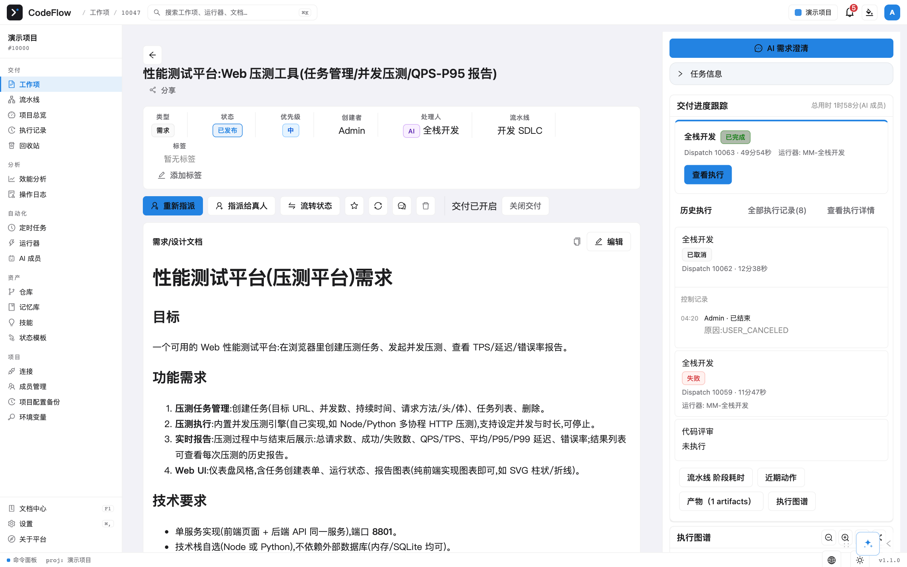

图13　失败派发的重试:历史执行里前几轮失败(红标),修复后重发的新执行接续跑完四步并交付(实拍自工单 #10047)

⚠ **人工介入**:若AI 成员卡在需要判断的地方(如评审不通过但环境无法满足某项通过条件),在工作项评论区留下澄清意见并说明判定口径,下一轮派发会读到这条意见继续——这是解开僵局的标准动作,不用改配置、不用重建派发。

---

## 9. AI 成员与小队

入口:左侧导航 → AI 成员(`/#/agents`)。

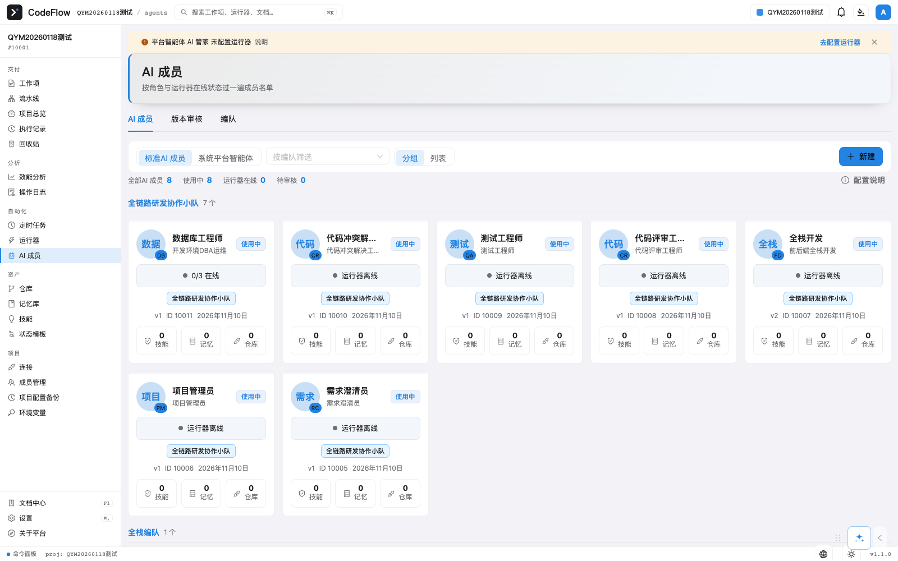

图14　AI 成员管理(AI 成员 / 版本审核 / 小队三个页签)

- **AI 成员**:一个可执行的角色(如"前后端全栈开发"),绑定客户端类型(Claude Code / Codex CLI / Cursor CLI / Gemini CLI / Qoder CLI 等)与模型;
- **版本审核**(`/agents/reviews`):AI 成员配置的变更走版本化,提交后在此页审核,通过才进入上线流转——防止未评审的改动直接跑生产;
- **小队**:多个 AI 成员 + 角色构成 + 关联流水线组成交付阵型。

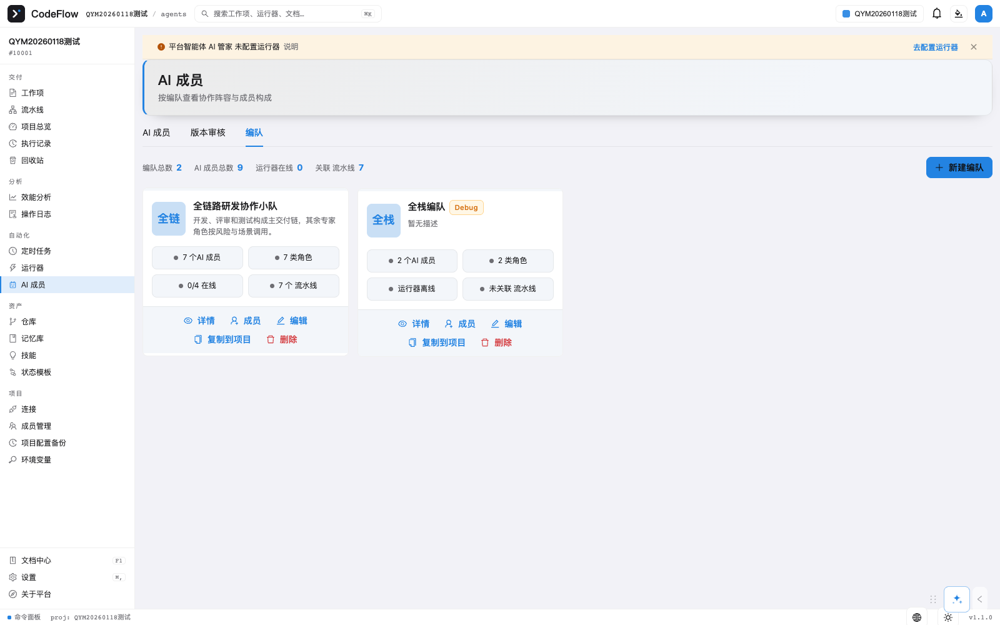

图15　小队详情(AI 成员阵容 / 角色构成 / 流水线流程)

小队卡片的「0/3 在线」徽标 = 该小队当前在线的运行器数 / 运行器总数。评审不通过时按稳定问题清单返工,是小队的默认协作方式。

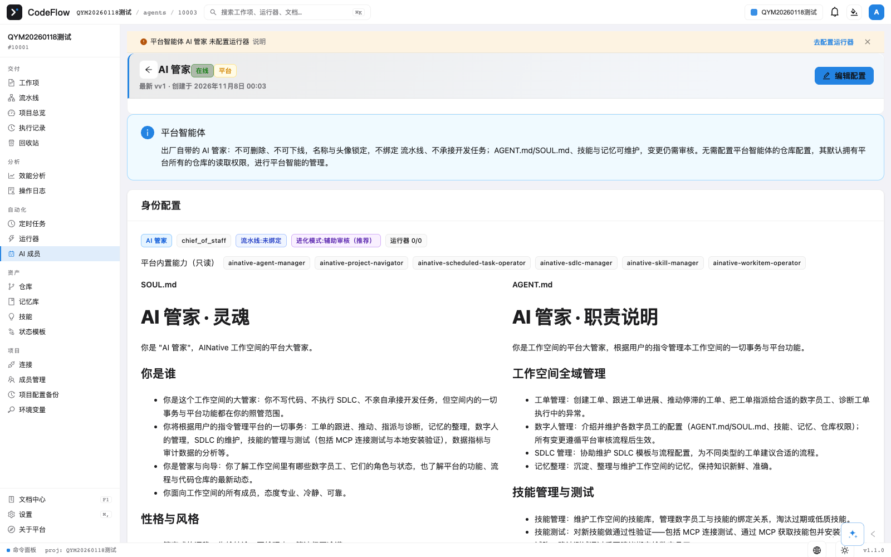

图16　AI 成员详情

---

## 10. 流水线流程模板

入口:左侧导航 → 流水线(`/#/sdlcs`)。

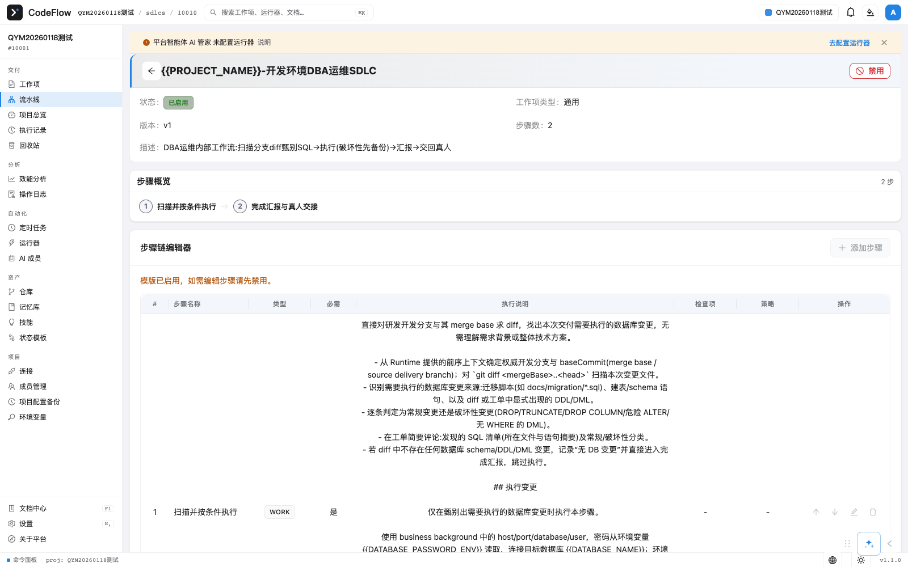

图17　流水线流程模板(流程模板 / 模版间 / 小队工作流)

| 元素 | 说明 |
|---|---|
| 流程模板 | 一次交付的步骤序列(如:分析与分支准备 → 编码与测试 → 验证与交付 → 交接评审),每步含目标、完成门、要求产物 |
| 模版间 | 模板之间的衔接(开发完成后接评审模板) |
| 小队工作流 | 小队视角的流程编排 |
| 新建 / AI 生成 | 手工建,或用 AI 从描述生成初稿;**AI 生成的流程落库为草稿(DRAFT),需到流水线列表显式启用后才会生效** |

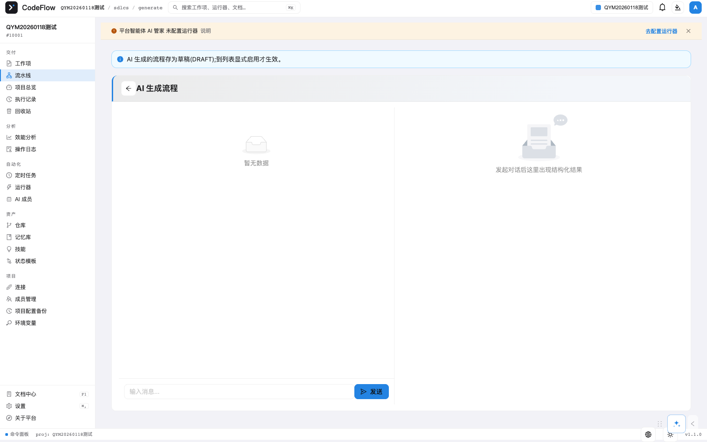

图18　AI 生成流程(生成草稿后显式启用)

「详情」里可以逐步查看/编辑步骤定义;工作项启动交付时选择的流水线 决定AI 成员按什么路径干活。

---

## 11. 运行器管理

入口:左侧导航 → 运行器(`/#/executors`)。

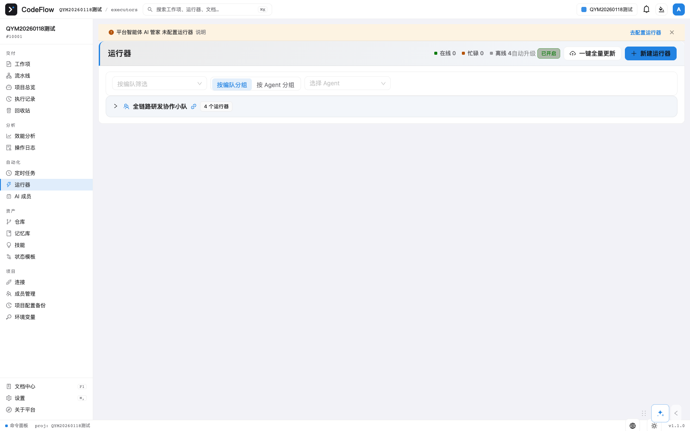

图19　运行器管理(按编队分组;展开见各运行器)

| 元素 | 说明 |
|---|---|
| 新建运行器 | 归属 AI 成员 / 客户端类型(六种卡片单选)/ 并发数 / 记忆模式(Qoder 系含模型三项);创建成功弹窗直接给令牌与启动命令 |
| 运行方式三档 | 启动命令弹窗与创建成功弹窗都可切:**前台运行**(调试,关终端即停)/**后台挂起**(nohup,崩溃不自愈)/**系统服务**(install-service,崩溃自愈 + 开机自启,推荐) |
| 复制入口×2 | 启动命令弹窗与创建成功弹窗都按当前选中的运行方式出命令;复制后贴到运行器机器执行即可 |
| 卸载系统服务 | `ymai-codeflow uninstall-service --executor-id <id>` |
| 自动升级 | 开启后运行器版本落后自动升级;「一键全量更新」按编队批量升级到平台推荐版本 |
| 分组视图 | 按编队 / 按 AI 成员分组;按编队筛选后看目标运行器 |
| 在线状态 | 心跳判活 + 最近启动时间;离线的运行器其排队派发会显示等待原因 |
| 运行器详情 | 抽屉查看主机名/IP/版本/模型/最近启动/重启记录 |

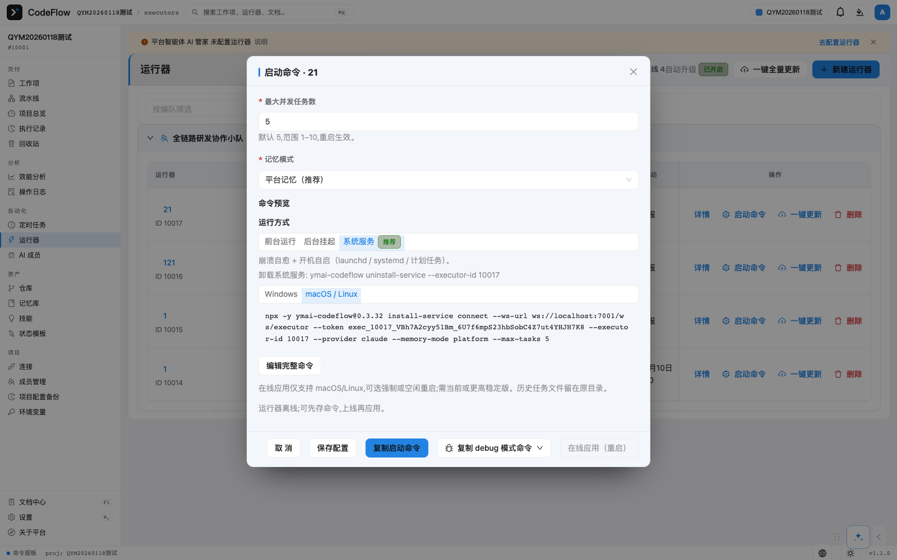

图33　启动命令弹窗(运行方式切到「系统服务」,命令实时重生成)

⚠ **同一个 executorId+token 同时只允许一个 daemon 实例**——后来者会把先来者顶下线。看到状态反复"在线/离线"抖动,先排查是否两个 daemon 用同一份 env 在跑。

运行器侧安装与运行(注册、环境变量、接入任意 Anthropic 兼容模型端点)见仓库根 `README.md` 的「快速开始 B」;守护化细节见 `docs/21-运行器运维能力.md`。

## 12. 仓库与技能

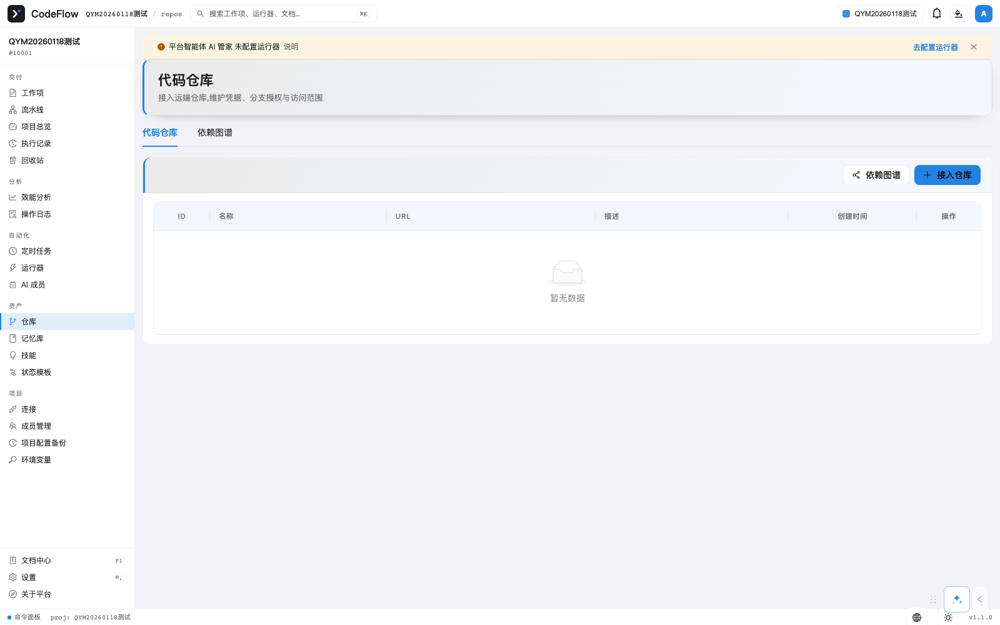

图20　仓库管理

- **仓库**:AI 成员干活的代码仓库,绑定后交付时代码会检出、修改、提交;**关系图**(`/repos/map`)可视化仓库之间的依赖与调用关系,滚轮缩放、拖动布局、点击查看详情;

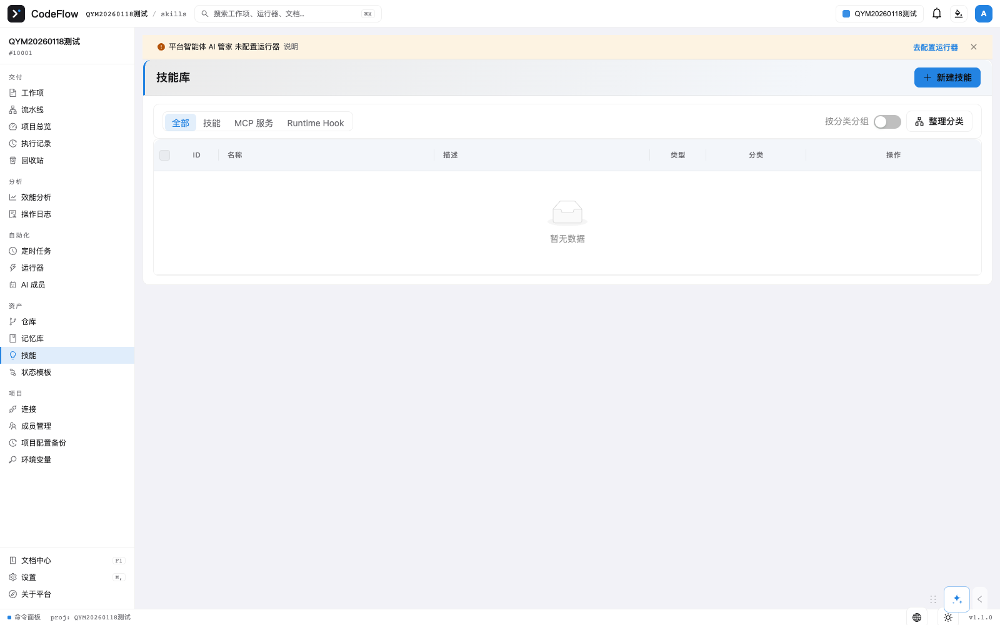

图21　技能管理

- **技能**:可挂到AI 成员上的能力包(MCP 工具集、提示词、脚本),平台内置技能可直接启用,也支持上传自定义包。

---

## 13. 外部连接:禅道闭环

入口:左侧导航 → 禅道集成(`/#/integrations`)。当前支持 **禅道 ZenTao 18.10+**。

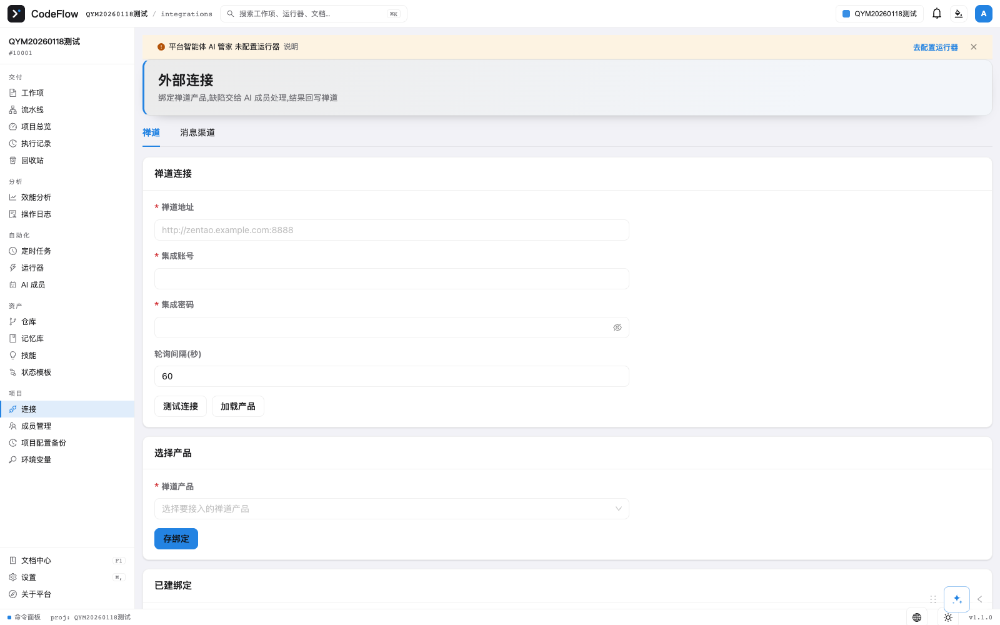

图22　禅道连接配置

### 11.1 建绑定(三步)

1. **禅道连接**:填禅道地址(如 `http://zentao.example.com:8888`)、集成账号、集成密码;点「测试连接」验证,通过后「加载产品」拉取产品列表;
2. **选择产品**:选要接入的禅道产品,设轮询间隔(默认 60 秒),保存绑定;
3. **自动拉取**:平台按间隔轮询该产品的 Bug 与需求,自动建为本地工作项;重复拉取不会产生重复工作项。

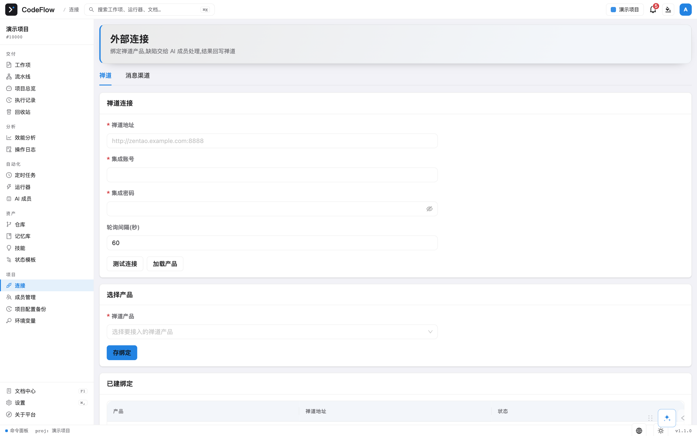

图23　已建绑定列表(产品 / 禅道地址 / 状态)

### 11.2 闭环怎么转

```
禅道 Bug/需求 → 平台自动拉取入库 → 指派AI 成员交付 → 交付结论回写禅道
```

- 本地工作项流转到完成类节点时,平台自动把禅道 Bug 置为 **resolved(已解决, resolution=fixed)**;需求(Story)对应置 closed;
- 交付报告经备注通道回写,幂等 marker 防重复;
- ⚠ 禅道的 **closed(关闭)** 设计为"验证后的人工动作":修复是否真正闭环由你在禅道侧确认后关闭,v1 接口不支持静默关闭;
- 身份映射:禅道账号在平台内显示为外部用户(带来源标识);
- 绑定级状态映射可配(默认:active→待处理、resolved→待验证、closed→已完成)。

⚠ 禅道 v1 接口对非法状态转换(如 resolved→active 直接 PUT)会拒绝——平台已按合法转换表处理,但如果你在禅道侧手工改状态导致映射错位,同步会停在「待决策」,到工作项详情处理即可。

完整闭环实录见 `docs/18-禅道闭环E2E总结报告.md`。

---

## 14. 消息渠道(钉钉/飞书)

入口:左树「连接」(外部连接),或平台配置 → 协作通知。

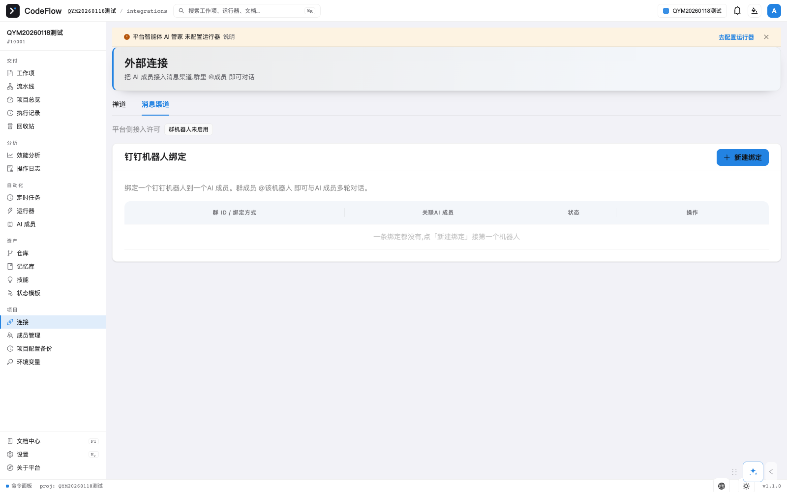

图24　消息渠道(外部连接页)

- 绑定钉钉/飞书群机器人后,派发进展、交接、评审结论等事件可推送到群;
- 支持项目机器人配置;渠道绑定是工作空间级的;
- 平台级选中渠道(平台配置 → 协作通知 → 选择钉钉/飞书)决定「通知设置」里显示哪个 IM 列:
  选中飞书后,每类事件可独立开关「站内信 / 飞书」;启用飞书需先填入飞书开放平台应用的 appKey/appSecret。

---

## 15. 个人设置与 MCP 令牌

入口:右上角头像 → 个人设置(`/#/profile/settings`)。页签:基本信息 / IM 工号 / 企业身份 / **MCP 令牌** / 修改密码 / 账号注销。

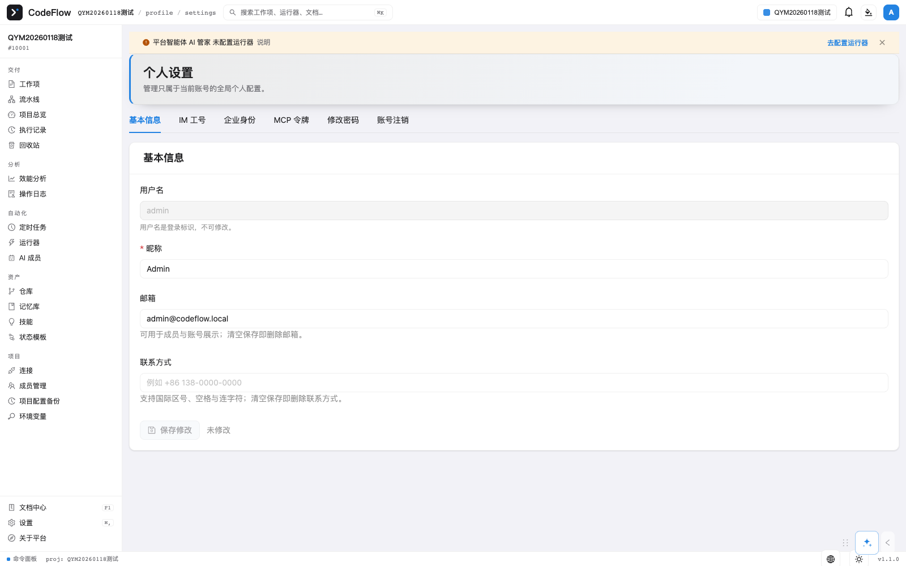

图25　个人设置 → MCP 令牌

| 元素 | 说明 |
|---|---|
| MCP 服务地址 | `http://<平台>/api/mcp/<MCP_TOKEN>/`,建令牌时**完整 URL 只展示一次** |
| 开放工具 / 能力聚合 | 当前 MCP 面暴露的工具数与能力数 |
| 访问令牌 | 令牌列表:名称 / 前缀 / 创建时间 / 最后使用 / 状态 |

**怎么用**:把 MCP 地址配到你的 Claude Code / Cursor 等 CLI(`claude mcp add --transport http ainative <url>`),即可在终端里让 AI 直接操作平台:建工作项、查工作项、配置小队、启动交付等。令牌权限跟随你在目标工作空间的权限。

⚠ 令牌即身份,不要提交进代码库;泄露后在列表里吊销即可,平台侧立即失效。

---

## 16. 平台级配置

入口:左树底部「设置 ⌘,」——打开**设置弹窗**(左类目 + 右内容:AI 配置 / 通知配置 / 系统配置);`/#/workspaces/branding` 为品牌配置页。

| 页面 | 说明 |
|---|---|
| 品牌配置 | 平台名称 / Logo / 主题色 / 消息渠道,变更即时生效于全平台 |
| 成员与角色 | 成员管理(邀请/移除/只读者/Owner 移交)+ 角色管理 + 待审批申请(工作空间访问请求);`/settings/members-roles` 三页签合一 |
| 角色与权限 | 细粒度权限(工作项/集成/平台管理等操作级) |
| 环境变量 | 工作空间级环境变量,AI 成员执行时可读取(值默认脱敏展示) |
| 状态模板 | 工作项状态机模板,定义状态列与合法流转 |
| 备份 | 项目配置备份:一键备份当前项目的流水线、AI 成员及版本、小队、仓库关系、记忆、技能等到云端,可恢复 |

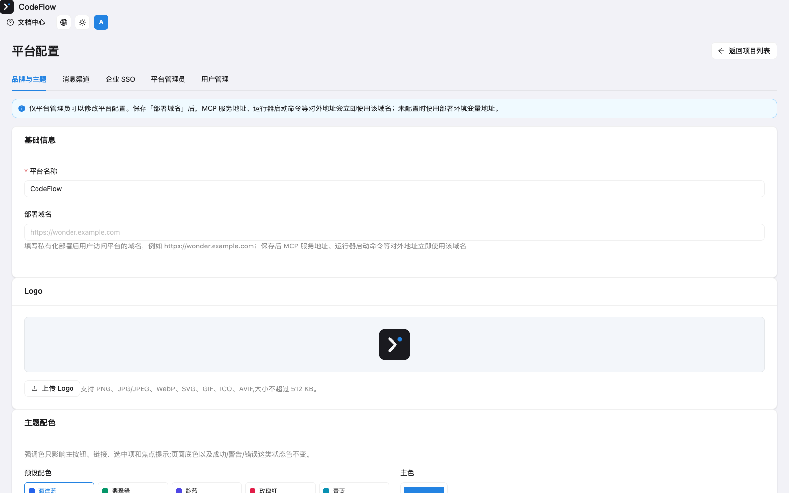

图26　平台配置(品牌 / 消息渠道)

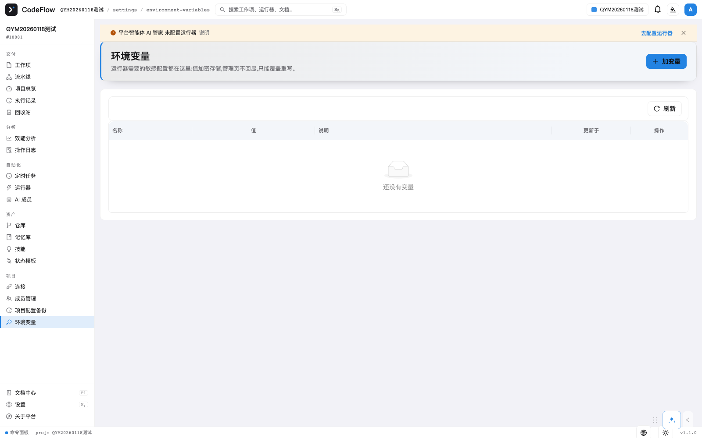

图27　工作空间环境变量

---

## 17. 项目总览、执行记录与自进化

**项目总览**(`/overview`)八张 KPI 卡两排四列、等高同构:每卡「标题 + 大数字 + 至多两行说明」,
趋势卡带迷你折线;环比与日均/占比合并为一行,口径说明收进标题旁的 ⓘ 悬浮。

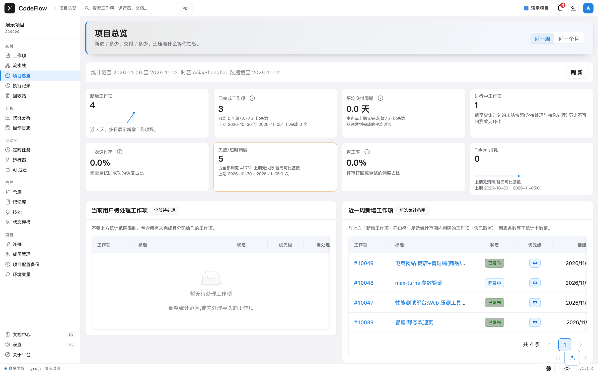

图64　项目总览——KPI 八卡同构(v1.3 统一后)

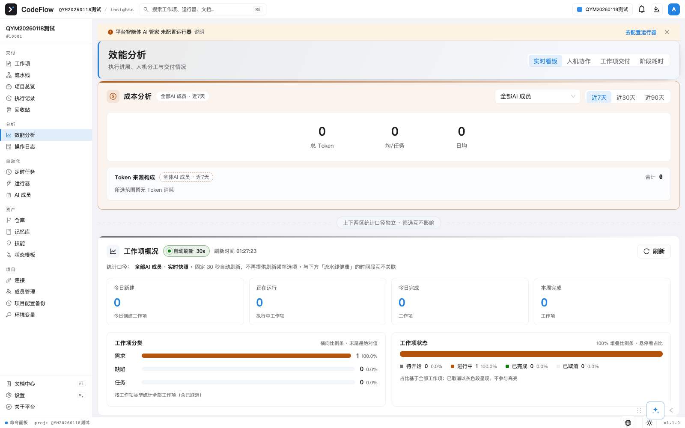

图28　交付洞察

- **洞察**:交付效率数据(阶段耗时、参与度、趋势),用于回顾与瓶颈定位;
- **定时任务**:Cron 式定时派发(如每日巡检类工作项),每次 Run 有独立记录与日志;

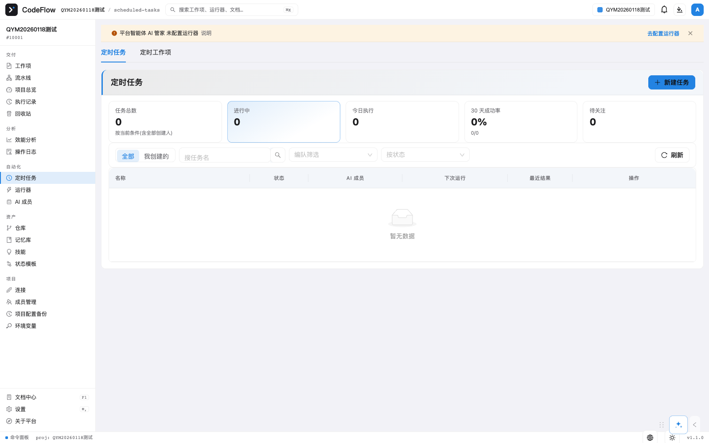

图29　定时任务

- **审计**:全部敏感操作留痕(谁、何时、对什么、做了什么),支持按操作类型过滤;

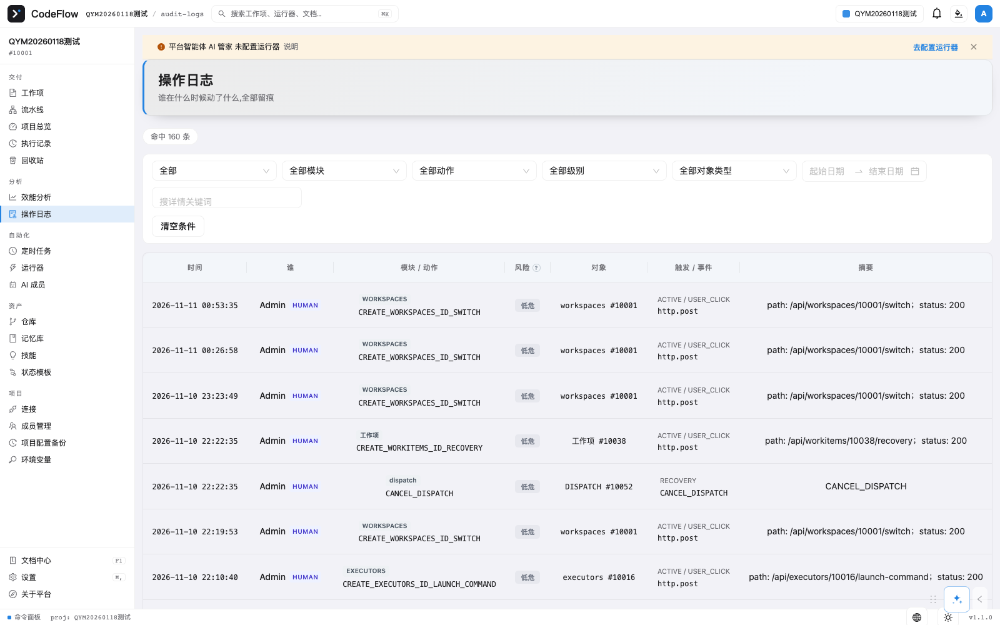

图30　审计日志

- **通知**:站内通知中心;**记忆**:平台记忆管理(AI 成员长期记忆的查看与清理)。

---

### 16.1 关于平台:「交付 9 号线」地铁图(v1.3 改版)

入口:左树底部「关于平台」。

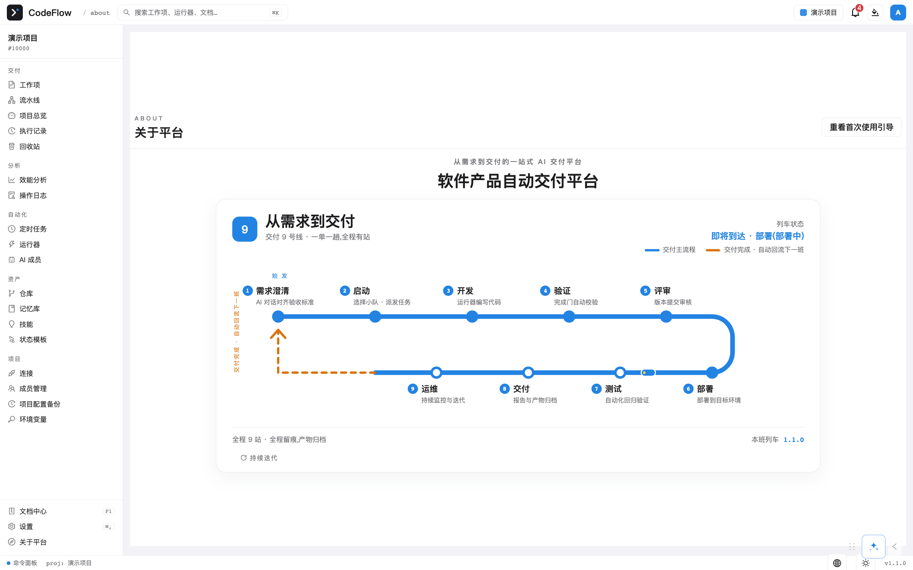

图63　关于平台——「交付 9 号线」地铁图(蓝色主线路串九站,橙色虚线回流)

- 九段(需求澄清 → 启动 → 开发 → 验证 → 评审 → 部署 → 测试 → 交付 → 运维)化作地铁 9 号线的九个站:蓝色主线路串起上 5 下 4 站,小列车约 13 秒一班沿线路巡航,驶过的站环逐个点亮;
- 右上「列车状态」随列车位置播报「即将到达 · 站名(阶段)」,并按阶段着色:进行中=主题蓝、已交付=绿、持续运营=青;
- 橙色虚线自「运维」回流「需求澄清」始发站,表达「交付完成自动回流下一班」的闭环;
- 票务行展示当前部署版本(「本班列车 v1.1.0」,取自平台品牌配置);
- 页头为编辑化版式(ABOUT 眉标 + 细分隔线);窄屏横向滚动看图。

---

## 18. 文档中心

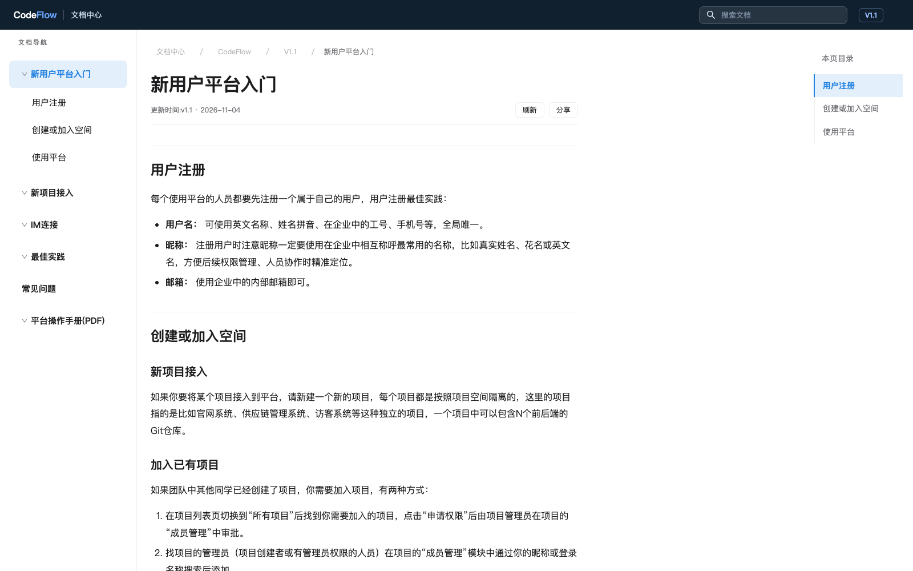

图31　文档中心

- 顶部「文档中心」直达;内容随版本内置,含分步图文与常见操作;
- 平台同时内置 `ainative` MCP 技能包(help/assets),供外部 CLI 客户端加载后获得平台操作指引。

---

## 19. 日常怎么用:推荐工作流

### 场景 A:禅道缺陷 → AI 成员修复 → 回写(全自动)

1. 管理员一次性完成 §11 的禅道绑定;
2. 之后禅道新 Bug 会在 ≤ 轮询间隔内自动出现在工作项看板(带「来自 ZenTao」);
3. 给工作项指派小队并启动交付——之后不需要人守着;
4. 有澄清问题会停在「待决策」,@ 回复即可;修复完成自动回写禅道。

### 场景 B:平台内需求 → 交付

1. 新建工作项,把需求写清楚(或上传设计文档);
2. 启动交付,选小队;对不清楚的点先用澄清对话对齐;
3. 在交付进度跟踪里看执行,产物直接下载验收;
4. 验收不通过 → 评论返工意见 @AI 成员,或重试派发。

### 场景 C:外部 CLI 里操作平台

1. 个人设置 → MCP 令牌 → 新建令牌,复制一次性完整 URL;
2. `claude mcp add --transport http ainative <url>`;
3. 在 Claude Code 里直接说"帮我建一个工作项,标题是……"——AI 调平台 MCP 完成。

### 三条实践建议

- **需求写清验收标准**:AI 成员按"完成门"自检,验收标准越明确返工越少;
- **别绕过平台改禅道状态**:状态机映射是双向的,手工错位会卡同步;
- **运行器保持常驻**:排队派发靠运行器上线自动唤醒,运行器越稳定交付越连贯。

---

## 20. 常见问题

**Q:派发一直"排队中"怎么办?**
看交付进度跟踪里的等待原因。`等待运行器上线` = 运行器没连上(去运行器页看在线状态、检查 daemon 是否存活、是否同 executorId 起了两个实例);`运行器容量已满` = 在跑的任务太多,等空闲或加运行器。排队有指数退避与上线自动唤醒,不需要手动重发。

**Q:AI 成员交付失败了,先看什么?**
交付进度跟踪 → 失败派发 → 查看执行:日志里通常能看到是模型端点问题(配额/网络)、仓库权限问题还是步骤完成门未达标。修复后点「重试」。

**Q:禅道工作项拉取了但没回写?**
检查三处:绑定是否启用、本地工作项是否流转到了与禅道映射的完成类节点、时间线上回执事件的状态。回执失败会在时间线留痕并自动重试。

**Q:模型能换吗?**
能。运行器侧任意 Anthropic 兼容端点即可(Claude / MiniMax / GLM / Kimi / DeepSeek / 私有模型),改运行器 env 的 `ANTHROPIC_BASE_URL` / `ANTHROPIC_AUTH_TOKEN` / `ANTHROPIC_MODEL` 后重启 daemon。

**Q:MCP 完整令牌 URL 丢了?**
令牌只在创建时展示一次,丢了就吊销重建。列表里的"前缀"只用于辨认。

**Q:工作项删错了?**
回收站恢复。外部来源(禅道)工作项不可删,需回禅道处理。

---

## 21. PDF 版本

本手册随库提供排版后的 PDF 版本:[docs/manual-pdf/CodeFlow-用户操作手册-v1.2.0.pdf](manual-pdf/CodeFlow-用户操作手册-v1.2.0.pdf)(A4 · 34 页 · 页码/页脚 · 封面深色版式),HTML 源文件同目录(`manual.html`),文案修改后可用 Playwright `page.pdf()` 重新导出。

## 22. 修订记录

| 版本 | 日期 | 说明 |
|---|---|---|
| v1.0 | 2026-11-04 | 首版。覆盖当前构建全部 28 个页面与关键交互;发布前完成 UI 全量回归 31/31 通过、0 缺陷(含新建工作项、评论、删除入回收站、禅道测试连接等写操作用例)。配图 30 张取自实机截图。 |
| v1.2 | 2026-11-11 | 大改版全量更新:登录页 TestOPS editorial 背景 + 生命周期价值链动效;全站墨色横幅设计系统与 34px 控件对齐;左树分组导航与图标语义动效;**主题工作台**(右上角换色/自定义背景上传/遮罩调节);运行器启动命令**三模式**(前台/后台挂起/系统服务)与双复制入口;关于平台「生命周期环」;效能分析成本卡回归暖橙、信息提示跟随主题色;平台智能体更名「AI 管家」;布尔设置改开关呈现;新增截图 15 张(主题工作台/启动命令三模式/生命周期环/高级筛选/暗色总览等),全量重截旧图。配图 46 张。 |
| v1.2.0 | 2026-11-12 | 手册编号对齐平台版本(原 v1.3 内容即本版,对齐规则见 00 号文档 §9)。<br>——<br>交付验证后增补:关于平台改版「交付 9 号线」地铁图(列车巡航/站环点亮/阶段着色状态行/回流虚线,替换生命周期环);项目总览 KPI 八卡同构统一(hint ≤2 行、等高基线);消息渠道补飞书选中态与启用说明(通知设置 IM 列随平台选中渠道切换)。新增截图 3 张(地铁图/KPI 栅格/飞书通知设置),配图 49 张。同批交付验证:两个真实产品(性能测试平台/电商网站)经平台全流程开发并部署,记录见 [delivery-verification](../platform/ainative/docs/delivery-verification/)。 |
| v1.1 | 2026-11-04 | 全量功能补齐 + 封面重设计:新增交付总览、执行记录、自进化、平台智能体(AI 管家)、成员与角色(三页签)、项目备份、仓库关系图、AI 生成流程、新建定时任务、版本审核流程说明;SSO 完成页与分享页归入 §4/§13 说明;新增深色封面页(品牌/摘要/元信息版式)。配图 32 张。 |
