# 19 · 用户操作手册

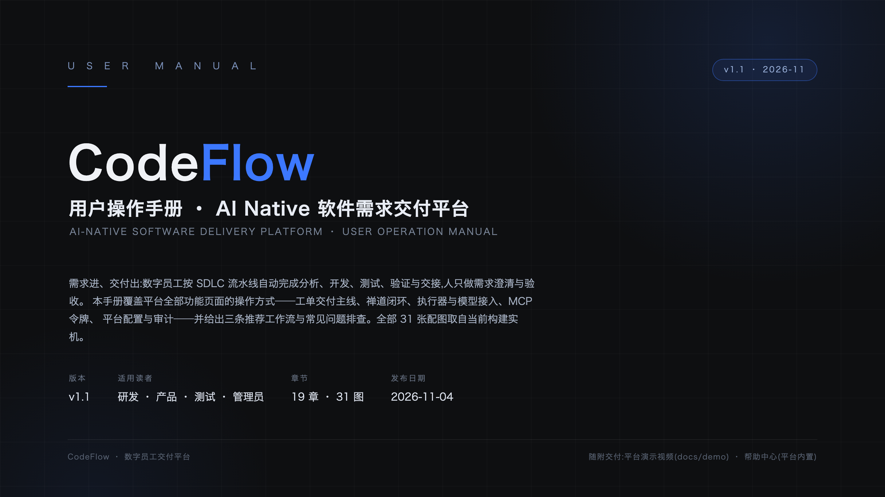

> 版本:v1.1(2026-11-04) · 适用平台:CodeFlow(当前构建)
> 适用读者:使用平台的研发 / 产品 / 测试同学,以及负责接入禅道与执行器的管理员
> 配图:共 31 张,均取自当前构建的实机截图(明色主题,除注明外;图10/13 截自真实交付过程的录屏)
> 本手册发布前的 UI 全量回归:31/31 通过、0 缺陷(覆盖登录、工作空间、工单全流程、小队、SDLC、执行器、集成、设置、审计等全部页面与关键交互)

---

## 目录

1. [登录与界面结构](#1-登录与界面结构)
2. [工作空间](#2-工作空间)
3. [总览大盘](#3-总览大盘)
4. [工单:从需求到交付的主线](#4-工单从需求到交付的主线)
5. [AI 需求澄清对话](#5-ai-需求澄清对话)
6. [交付进度跟踪:看数字员工干活](#6-交付进度跟踪看数字员工干活)
7. [数字员工与小队](#7-数字员工与小队)
8. [SDLC 流程模板](#8-sdlc-流程模板)
9. [执行器管理](#9-执行器管理)
10. [仓库与技能](#10-仓库与技能)
11. [平台集成:禅道闭环](#11-平台集成禅道闭环)
12. [消息渠道(钉钉/飞书)](#12-消息渠道钉钉飞书)
13. [个人设置与 MCP 令牌](#13-个人设置与-mcp-令牌)
14. [平台级配置](#14-平台级配置)
15. [洞察、定时任务与审计](#15-洞察定时任务与审计)
16. [帮助中心](#16-帮助中心)
17. [日常怎么用:推荐工作流](#17-日常怎么用推荐工作流)
18. [常见问题](#18-常见问题)
20. [修订记录](#20-修订记录)

---

## 1. 登录与界面结构

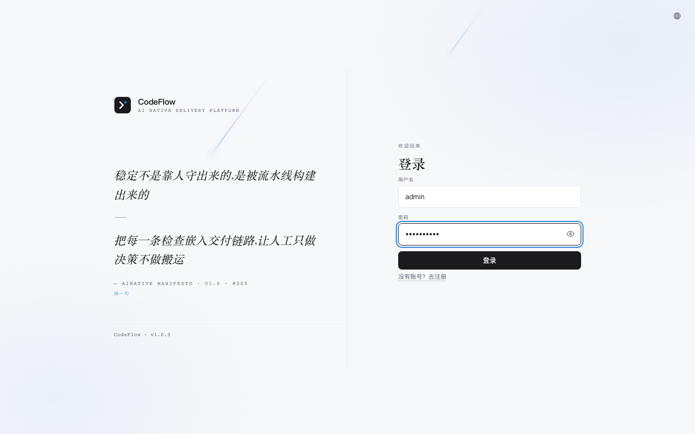

图1　登录页

- 首次部署通过 `http://<平台地址>:7001/register` 注册首个用户,**建组织即成为管理员**;之后所有成员从登录页进入。
- 登录页固定亮色,不随主题变化;语言跟随浏览器,可在登录后右上角切换。

登录后的整体布局:

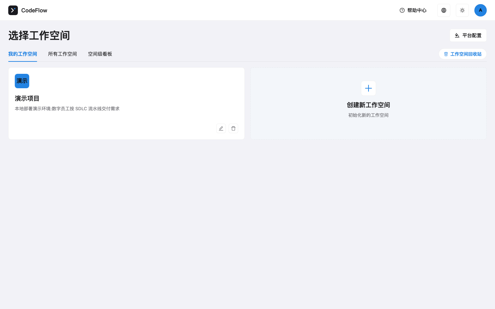

图2　工作空间选择页(登录后第一站)

| 区域 | 说明 |
|---|---|
| 左侧图标导航 | 纵向图标轨:看板 / 工单 / 定时任务 / 回收站 / 仓库 / 技能 / 洞察 / 数字员工 / 禅道集成 / 通知 / 记忆 / 成员 / 下载 / 设置,按使用频率排列 |
| 顶部通栏 | 平台级提示条(如"平台智能体未配置执行器"),可关闭;右侧固定入口:帮助中心 |
| 内容区 | 各功能页。列表类页面均为"左列卡片区 + 右侧详情/操作面板",不跳页 |
| 右下角浮层 | 反馈/客服入口与操作结果提示 |

主题(明/暗)在个人偏好中切换,跟随平台设计令牌;所有图表随主题重绘。

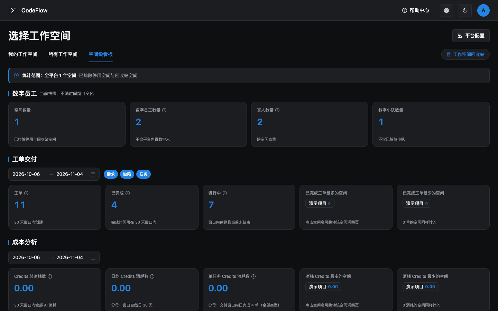

图3　暗色主题下的总览大盘

---

## 2. 首次使用引导

第一次登录并选择工作空间后,系统自动进入 4 步引导页(`/onboarding`,可随时跳过,也能从「关于平台」页重放):

| 步 | 内容 | 要点 |
|---|---|---|
| 1 认识模型 | 「需求进 · 交付出」的流水线示意 | 记住关键认知:数字员工由你部署的**执行器**驱动,不在浏览器里 |
| 2 跑起执行器(必做) | 可复制的启动代码块 + 实时探测 | 在「执行器」页注册拿到 ID/Token → 机器上配 env → 启动 daemon;本页每 3 秒自动探测,**状态变绿即可继续** |
| 3 认识预置阵容 | 开发与评审小队、两个数字员工、两套 SDLC 模板 | 开箱可用;自定义小队 / AI 生成 SDLC / 登记仓库为可选 |
| 4 打通需求源 | 禅道绑定三要素 + 测试连接 | 可选:跳过也能直接「新建工单」体验交付 |

- 引导状态保存在浏览器本地;换浏览器或清除存储后会再次出现,点「完成」即不再提示。
- 未配置执行器时点「跳过引导」会二次确认(防止新手漏掉关键一步)。


## 3. 工作空间

- 登录后先选**工作空间**;工单、小队、SDLC、执行器、集成等所有业务数据都归属某个工作空间。
- 管理员可在「成员」页邀请新成员并分配角色;一个用户可属于多个工作空间,顶部标签页可随时切换(我的工作空间 / 所有工作空间)。
- 「空间级看板」提供跨页面的汇总视角(数字员工数、工单交付量、Credits 消耗分析):

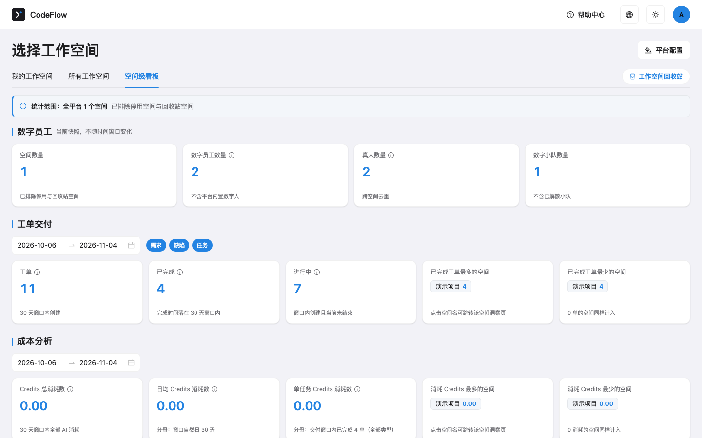

图4　空间级看板(交付量与成本消耗汇总)

⚠ 工作空间删除会级联影响其下工单与配置,属高危操作,请先在「回收站/备份」确认后再执行。

---

## 4. 总览大盘

入口:左侧导航 → 看板(`/#/workspaces/dashboard`)。

大盘回答三个问题:**现在有多少活、干到哪了、谁在干**。工单按状态分列(待处理 / 执行中 / 待决策 / 已完成),异常派发直接在卡片上标红。

日常读法:

1. 先看「执行中」列有没有 `异常` 红标——那是需要人工介入的派发;
2. 再看「待决策」列——那是等你拍板的工单(澄清回复、验收);
3. 「已完成」列看今天交付了什么。

---

## 5. 工单:从需求到交付的主线

### 4.1 工单列表

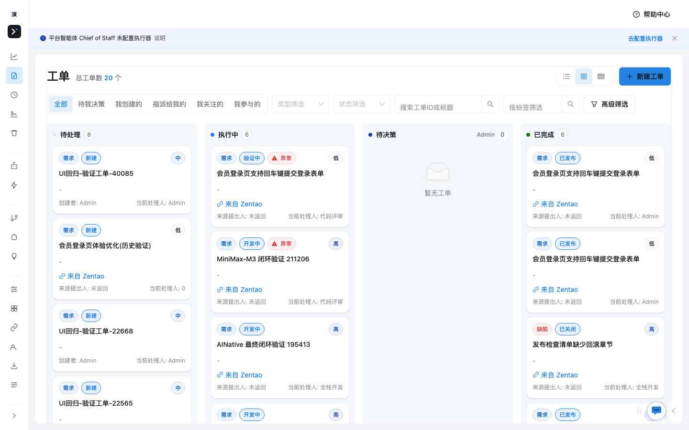

图5　工单看板(状态分列卡片式)

| 元素 | 说明 |
|---|---|
| 范围页签 | 全部 / 待我决策 / 我创建的 / 指派给我的 / 我关注的 / 我参与的 |
| 类型/状态筛选 | 按工单类型(需求/缺陷)与状态节点过滤 |
| 搜索框 | 按工单 ID 或标题搜索 |
| 标签筛选 / 高级筛选 | 组合条件;高级筛选支持优先级、创建者等更多维度 |
| 卡片 | 类型、状态、优先级、标题、创建者、当前处理人;**外部来源工单带「来自 ZenTao」链接**,点击直达禅道原始对象 |
| 视图切换 | 看板 / 列表 / 表格三种视图 |

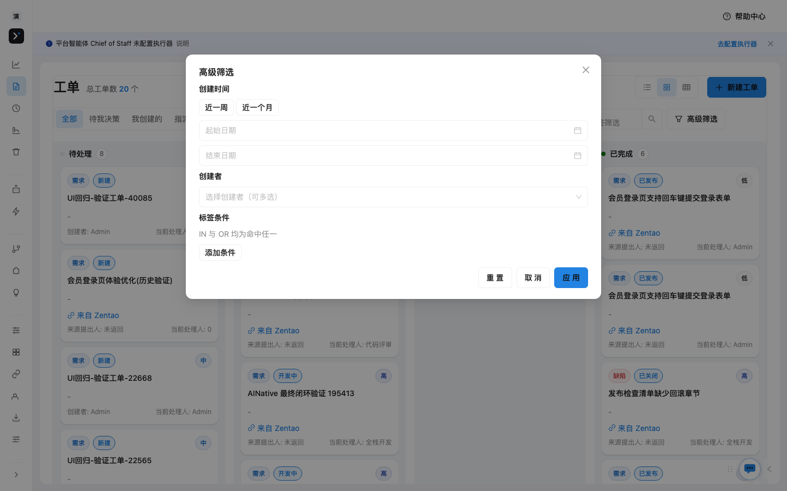

图6　工单高级筛选

### 4.2 新建工单

入口:工单页右上角「+ 新建工单」。

必填:**类型**(需求/缺陷)、**标题**、**需求/设计文档**(Markdown);可选:优先级。
创建后进入工单详情页。工单支持上传需求/设计上下文附件(任意类型,单个 5MB、总共 20MB,可粘贴截图)。

### 4.3 工单详情


图7　工单详情(新建工单)

| 元素 | 说明 |
|---|---|
| 元信息条 | 类型 / 状态 / 优先级 / 创建者 / 处理人 / 标签,状态与标签可直接改 |
| 启动交付 | 指派数字员工并按 SDLC 启动自动交付(见 §4.4) |
| 指派真人 / 流转状态 | 人工接棒与状态流转 |
| 需求/设计文档 | Markdown 编辑;外部来源工单只读并显示「由外部工单维护」 |
| 评论 & 时间线 | 全部沟通与系统事件(创建/流转/派发/交接/回写)按时间倒序 |
| 右栏 | AI 需求澄清(§5)、任务信息、交付进度跟踪(§6) |
| 分享 | 生成只读分享链接(产物页无需登录可看) |

外部来源工单(禅道拉取)在标题下显示来源标识,删除受保护——**必须回禅道处理,平台侧不可删**。

下面是一个真实交付中的工单:左侧是需求正文(由外部工单维护,只读),右栏是实时交付进度:

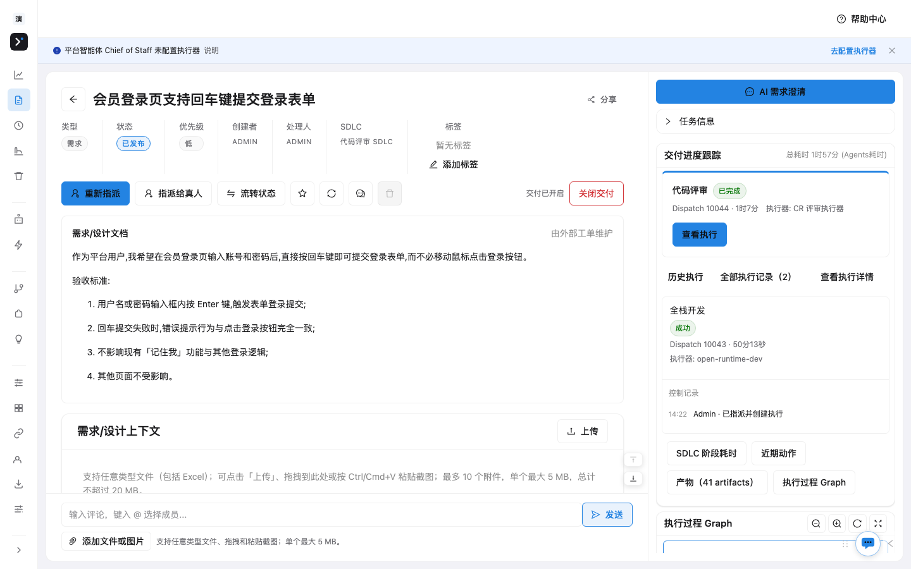

图8　真实交付中的工单(外部来源 + 右栏实时交付面板)

发评论的即时反馈(左下角「评论已发送」提示):


图9　发表评论成功

### 4.4 启动交付(把活交给数字员工)

1. 点「启动交付」→ 右栏进入「AI 需求澄清」向导,选择小队与数字员工;
2. 确认后平台创建派发(dispatch),工单进入「执行中」;
3. 执行器在线时立即开始跑 SDLC;离线则排队等待并显示原因(§6)。

交付开启后,工单右上出现「关闭交付」;关闭后不再接受新的自动派发,评论区 @ 数字员工也会被拦截提示。

### 4.5 删除与回收站

删除工单进入回收站(左侧导航垃圾桶图标),可恢复;外部来源工单不可删除。

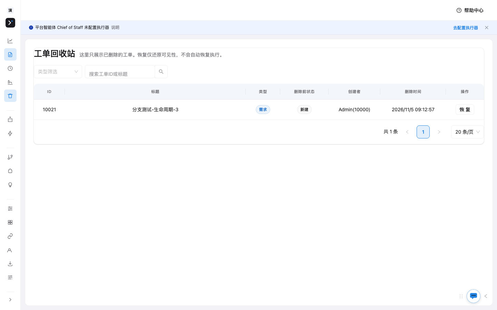

图10　工单回收站

---

## 6. AI 需求澄清对话

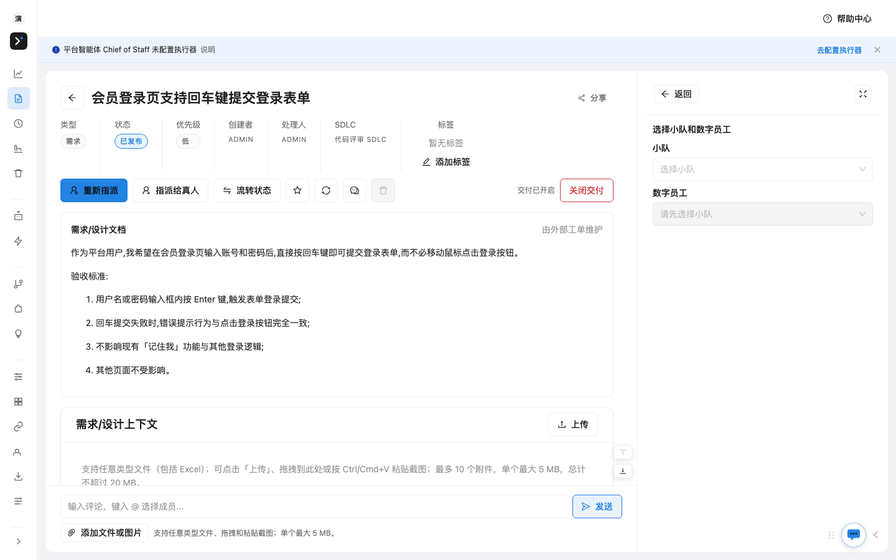

图11　工单详情右栏的 AI 需求澄清向导

- **启动交付前**:右栏「AI 需求澄清」进入向导,按小队 → 数字员工两级选择交付主体;
- **交付中**:直接在评论区 `@数字员工` 提问,数字员工经平台 MCP **实时读取工单内容**后作答与追问,形成澄清会话;
- 数字员工的每次回复都带用量(模型/Token)与耗时,可在时间线追溯。

⚠ 需求描述写不清是交付返工的最大来源。建议启动交付前先用澄清对话把验收标准对齐——这比事后返工便宜得多。

---

## 7. 交付进度跟踪:看数字员工干活


图12　交付进度跟踪面板(当前派发 + 历史执行)

| 元素 | 说明 |
|---|---|
| 当前派发卡 | 数字员工 / SDLC 步骤 / 状态(含 失败 红标)/ Dispatch ID / 耗时 / 执行器名 |
| 查看执行 | 打开该派发的实时执行视图(终端/日志) |
| 重试 | 失败后原样重发 |
| 历史执行 | 全部执行记录(含交接产生的下游派发),可看执行详情 |
| 控制记录 | 指派 / 暂停 / 恢复 / 停止等人工操作留痕 |
| SDLC 阶段耗时 / 近期动作 | 每一步耗时与最新进展 |
| 产物 | 数字员工产出的文件(deliverables),可直接下载 |
| 执行过程 Graph | 步骤与交接的图形化视图 |

**排队原因会明说**:执行器不在线时派发不会空转,而是按指数退避等待,面板直接显示原因(如"等待执行器上线")与最近一次尝试;执行器上线后自动唤醒,无需人工重发。

**失败了就地重试**:某次派发失败(模型配额、基础设施中断等)时,面板给出「重试」按钮,原样重发一次并记为新 attempt,前几轮执行记录全部保留可查:

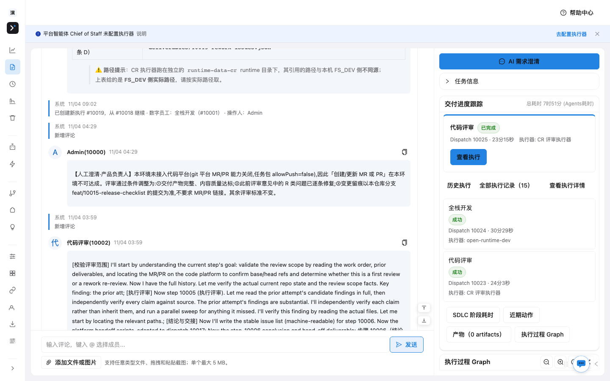

图13　失败派发的重试:历史执行里 10016 失败(红标),点「重试」后创建新执行 10017 并接续(控制记录:从 #10016 继续)

⚠ **人工介入**:若数字员工卡在需要判断的地方(如评审不通过但环境无法满足某项通过条件),在工单评论区留下澄清意见并说明判定口径,下一轮派发会读到这条意见继续——这是解开僵局的标准动作,不用改配置、不用重建派发。

---

## 8. 数字员工与小队

入口:左侧导航 → 数字员工(`/#/agents`)。

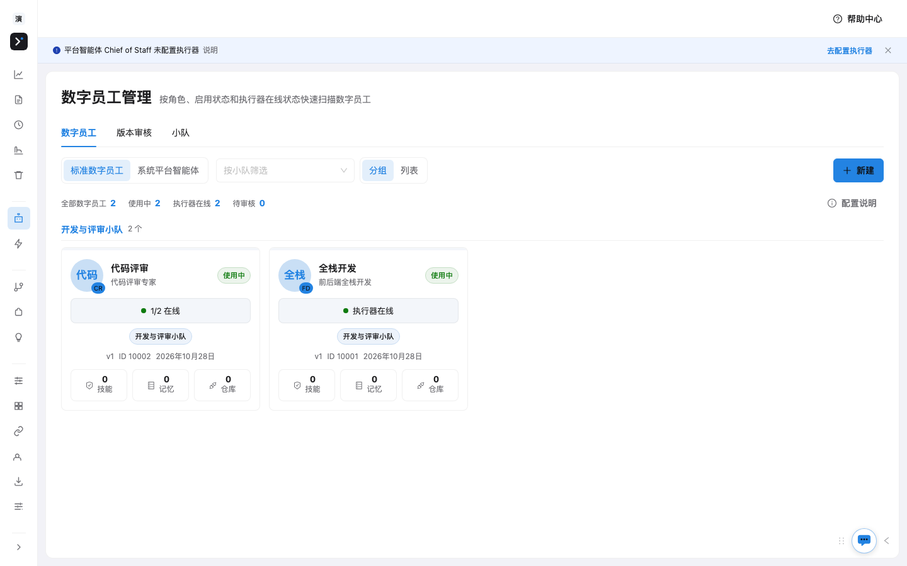

图14　数字员工管理(数字员工 / 版本审核 / 小队三个页签)

- **数字员工**:一个可执行的角色(如"前后端全栈开发"),绑定客户端类型(Claude Code / Codex CLI / Cursor CLI / Gemini CLI / Qoder CLI 等)与模型;
- **版本审核**(`/agents/reviews`):数字员工配置的变更走版本化,提交后在此页审核,通过才进入上线流转——防止未评审的改动直接跑生产;
- **小队**:多个数字员工 + 角色构成 + 关联 SDLC 组成交付阵型。

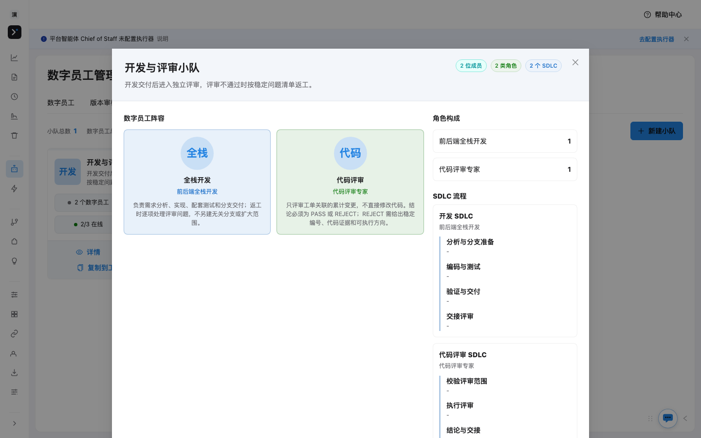

图15　小队详情(数字员工阵容 / 角色构成 / SDLC 流程)

小队卡片的「0/3 在线」徽标 = 该小队当前在线的执行器数 / 执行器总数。评审不通过时按稳定问题清单返工,是小队的默认协作方式。

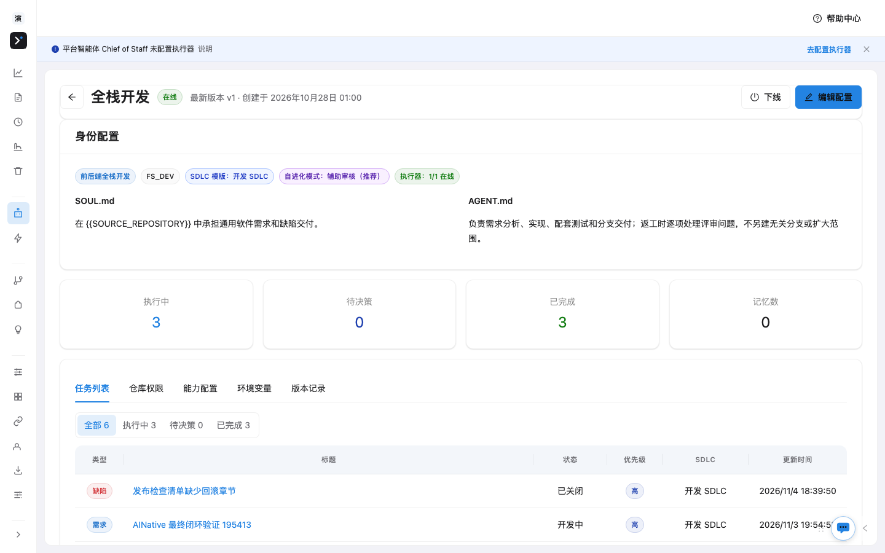

图16　数字员工详情

---

## 9. SDLC 流程模板

入口:左侧导航 → SDLC(`/#/sdlcs`)。

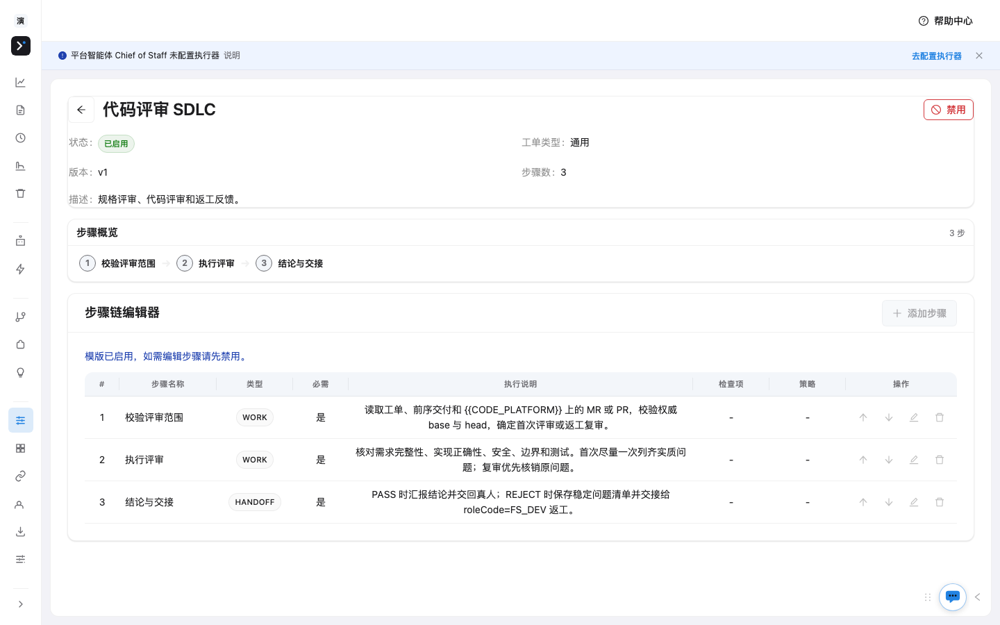

图17　SDLC 流程模板(流程模板 / 模版间 / 小队工作流)

| 元素 | 说明 |
|---|---|
| 流程模板 | 一次交付的步骤序列(如:分析与分支准备 → 编码与测试 → 验证与交付 → 交接评审),每步含目标、完成门、要求产物 |
| 模版间 | 模板之间的衔接(开发完成后接评审模板) |
| 小队工作流 | 小队视角的流程编排 |
| 新建 / AI 生成 | 手工建,或用 AI 从描述生成初稿;**AI 生成的流程落库为草稿(DRAFT),需到 SDLC 列表显式启用后才会生效** |

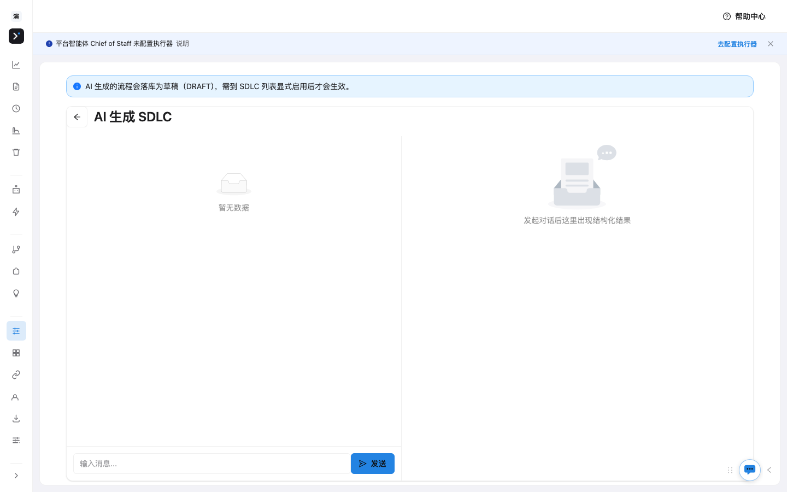

图18　AI 生成 SDLC(生成草稿后显式启用)

「详情」里可以逐步查看/编辑步骤定义;工单启动交付时选择的 SDLC 决定数字员工按什么路径干活。

---

## 10. 执行器管理

入口:左侧导航 → 执行器(`/#/executors`)。

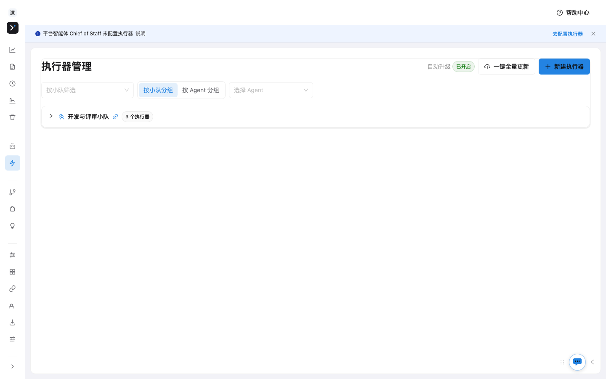

图19　执行器管理(按小队分组,展开见各执行器)

| 元素 | 说明 |
|---|---|
| 新建执行器 | 生成注册命令;在执行器机器上执行 `register_executor.py` 即完成注册 |
| 自动升级 | 开启后执行器版本落后自动升级 |
| 一键全量更新 | 全部执行器升级到平台推荐版本 |
| 分组视图 | 按小队 / 按 Agent 分组;筛选后看目标执行器 |
| 在线状态 | 心跳判活;离线的执行器其排队派发会显示等待原因 |

⚠ **同一个 executorId+token 同时只允许一个 daemon 实例**——后来者会把先来者顶下线。部署时一个执行器一个进程;看到状态反复"在线/离线"抖动,先排查是否有两个 daemon 用同一份 env 在跑。

执行器侧的安装与运行(注册、环境变量、模型接入任意 Anthropic 兼容端点)见仓库根 `README.md` 的「快速开始 B」。

---

## 11. 仓库与技能

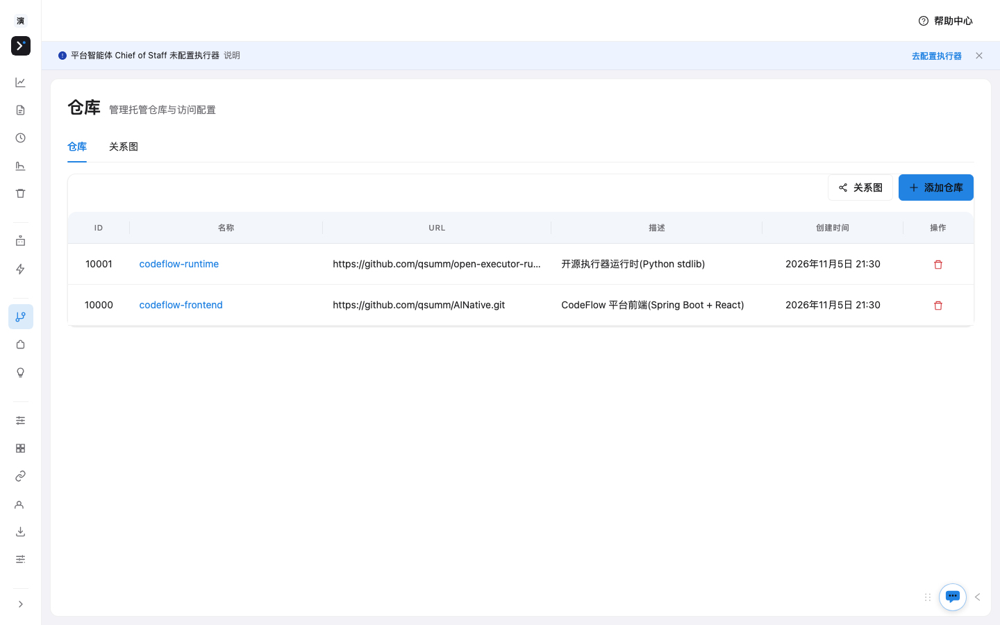

图20　仓库管理

- **仓库**:数字员工干活的代码仓库,绑定后交付时代码会检出、修改、提交;**关系图**(`/repos/map`)可视化仓库之间的依赖与调用关系,滚轮缩放、拖动布局、点击查看详情;

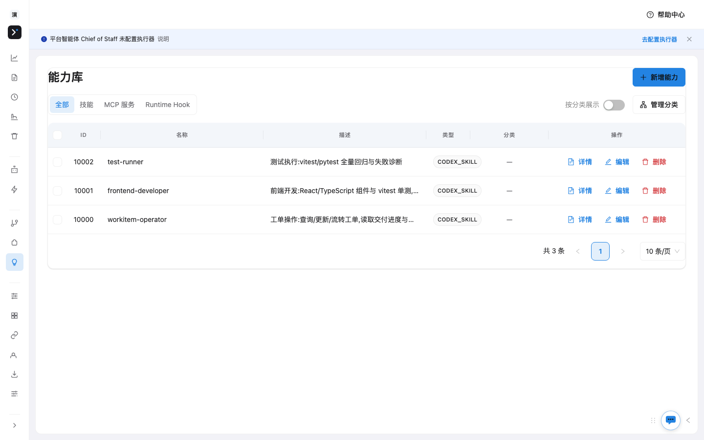

图21　技能管理

- **技能**:可挂到数字员工上的能力包(MCP 工具集、提示词、脚本),平台内置技能可直接启用,也支持上传自定义包。

---

## 12. 平台集成:禅道闭环

入口:左侧导航 → 禅道集成(`/#/integrations`)。当前支持 **禅道 ZenTao 18.10+**。

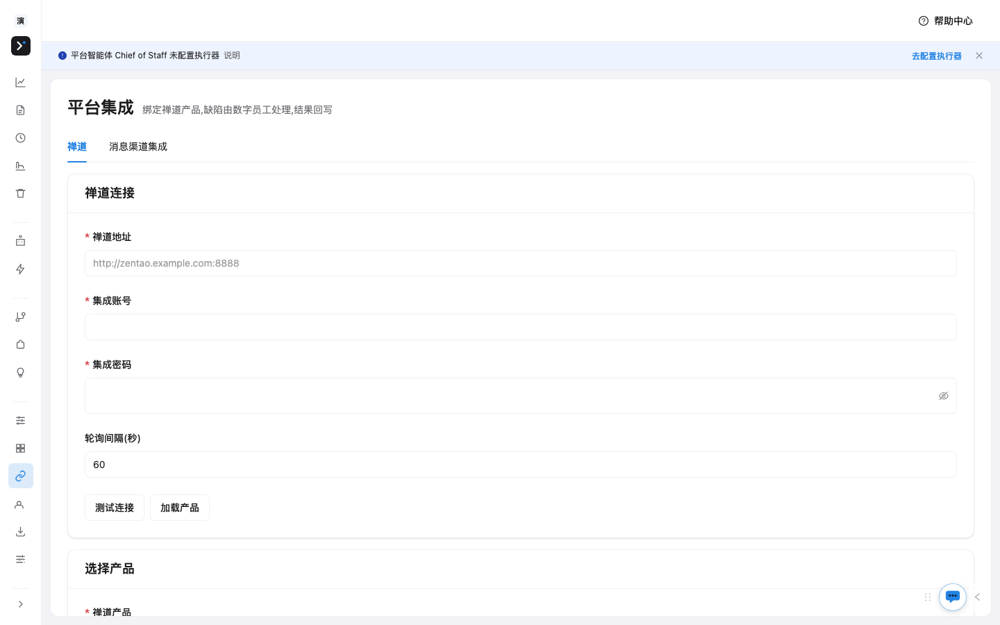

图22　禅道连接配置

### 11.1 建绑定(三步)

1. **禅道连接**:填禅道地址(如 `http://zentao.example.com:8888`)、集成账号、集成密码;点「测试连接」验证,通过后「加载产品」拉取产品列表;
2. **选择产品**:选要接入的禅道产品,设轮询间隔(默认 60 秒),保存绑定;
3. **自动拉取**:平台按间隔轮询该产品的 Bug 与需求,自动建为本地工单;重复拉取不会产生重复工单。

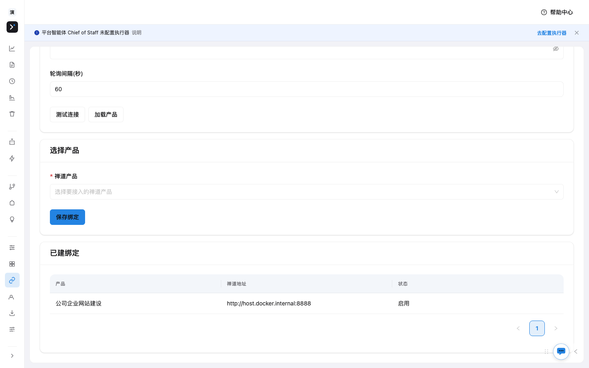

图23　已建绑定列表(产品 / 禅道地址 / 状态)

### 11.2 闭环怎么转

```
禅道 Bug/需求 → 平台自动拉取入库 → 指派数字员工交付 → 交付结论回写禅道
```

- 本地工单流转到完成类节点时,平台自动把禅道 Bug 置为 **resolved(已解决, resolution=fixed)**;需求(Story)对应置 closed;
- 交付报告经备注通道回写,幂等 marker 防重复;
- ⚠ 禅道的 **closed(关闭)** 设计为"验证后的人工动作":修复是否真正闭环由你在禅道侧确认后关闭,v1 接口不支持静默关闭;
- 身份映射:禅道账号在平台内显示为外部用户(带来源标识);
- 绑定级状态映射可配(默认:active→待处理、resolved→待验证、closed→已完成)。

⚠ 禅道 v1 接口对非法状态转换(如 resolved→active 直接 PUT)会拒绝——平台已按合法转换表处理,但如果你在禅道侧手工改状态导致映射错位,同步会停在「待决策」,到工单详情处理即可。

完整闭环可在平台集成页发起验证。

---

## 13. 消息渠道(钉钉/飞书)

入口:平台集成 → 消息渠道集成,或平台配置 → 消息渠道。

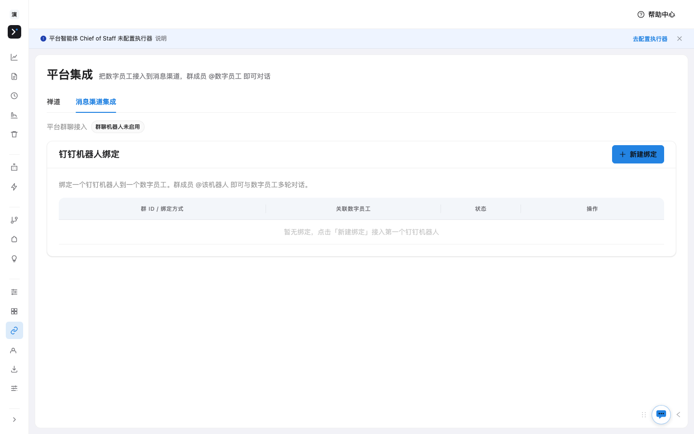

图24　消息渠道集成

- 绑定钉钉/飞书群机器人后,派发进展、交接、评审结论等事件可推送到群;
- 支持项目机器人配置;渠道绑定是工作空间级的。

---

## 14. 个人设置与 MCP 令牌

入口:右上角头像 → 个人设置(`/#/profile/settings`)。页签:基本信息 / IM 工号 / 企业身份 / **MCP 令牌** / 修改密码 / 账号注销。

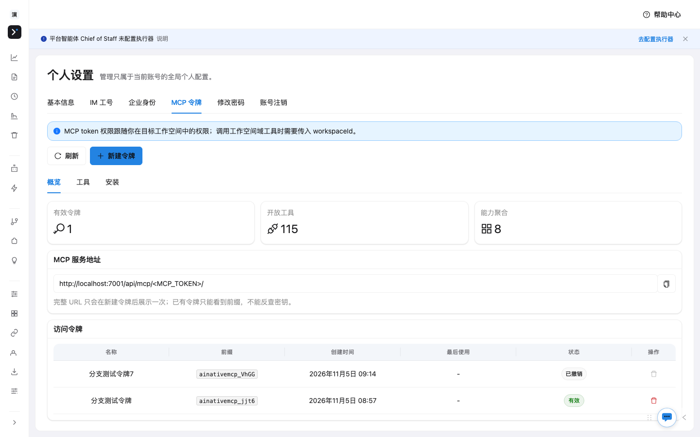

图25　个人设置 → MCP 令牌

| 元素 | 说明 |
|---|---|
| MCP 服务地址 | `http://<平台>/api/mcp/<MCP_TOKEN>/`,建令牌时**完整 URL 只展示一次** |
| 开放工具 / 能力聚合 | 当前 MCP 面暴露的工具数与能力数 |
| 访问令牌 | 令牌列表:名称 / 前缀 / 创建时间 / 最后使用 / 状态 |

**怎么用**:把 MCP 地址配到你的 Claude Code / Cursor 等 CLI(`claude mcp add --transport http ainative <url>`),即可在终端里让 AI 直接操作平台:建工单、查工单、配置小队、启动交付等。令牌权限跟随你在目标工作空间的权限。

⚠ 令牌即身份,不要提交进代码库;泄露后在列表里吊销即可,平台侧立即失效。

---

## 15. 平台级配置

入口:设置(左侧导航底部)与 `/#/workspaces/branding`。

| 页面 | 说明 |
|---|---|
| 品牌配置 | 平台名称 / Logo / 主题色 / 消息渠道,变更即时生效于全平台 |
| 成员与角色 | 成员管理(邀请/移除/只读者/Owner 移交)+ 角色管理 + 待审批申请(工作空间访问请求);`/settings/members-roles` 三页签合一 |
| 角色与权限 | 细粒度权限(工单/集成/平台管理等操作级) |
| 环境变量 | 工作空间级环境变量,数字员工执行时可读取(值默认脱敏展示) |
| 状态模板 | 工单状态机模板,定义状态列与合法流转 |
| 备份 | 项目配置备份:一键备份当前项目的 SDLC、数字员工及版本、小队、仓库关系、记忆、技能等到云端,可恢复 |

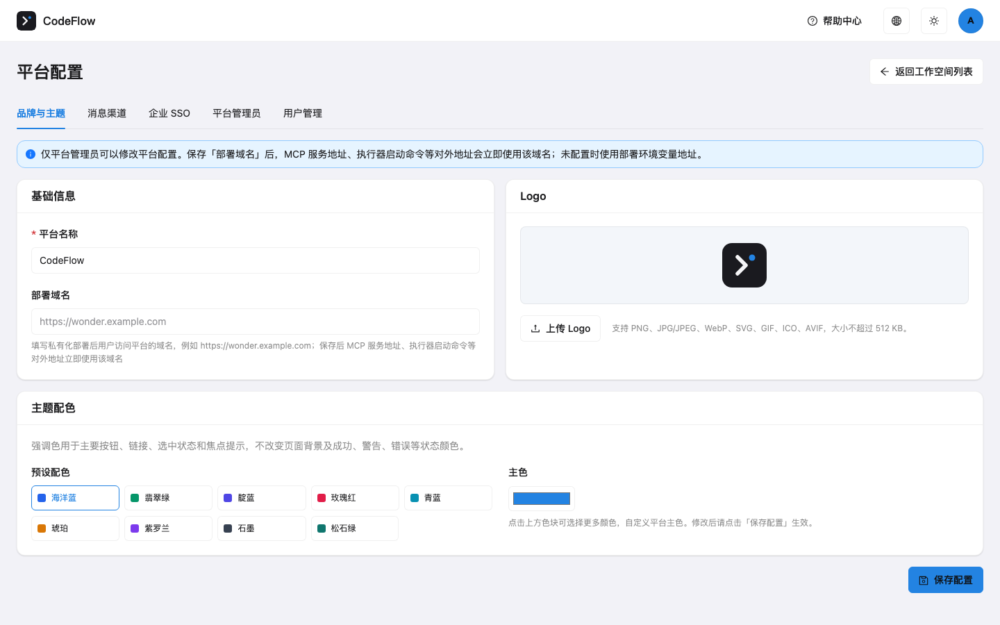

图26　平台配置(品牌 / 消息渠道)

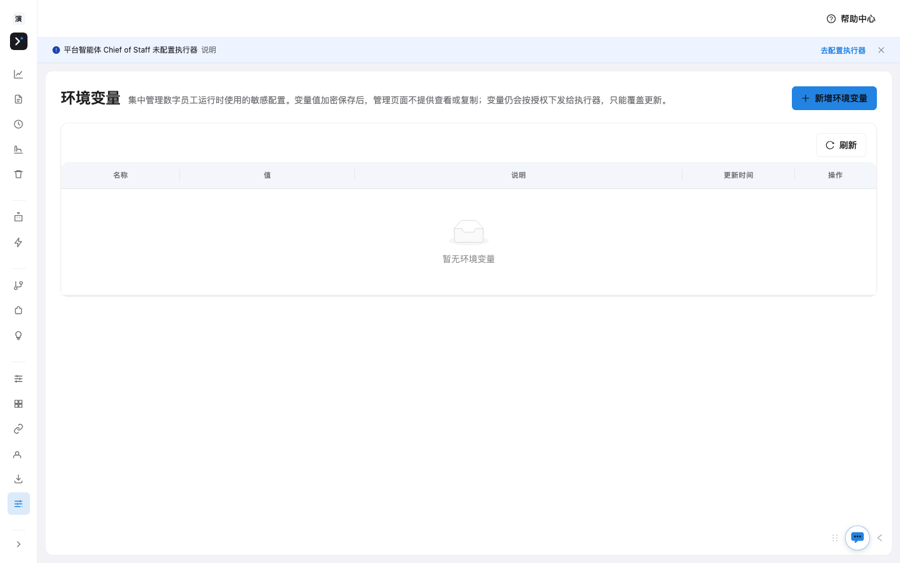

图27　工作空间环境变量

---

## 16. 交付总览、执行记录与自进化

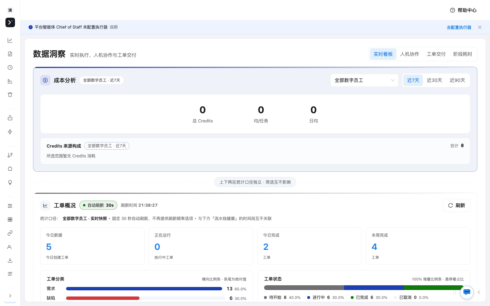

图28　交付洞察

- **洞察**:交付效率数据(阶段耗时、参与度、趋势),用于回顾与瓶颈定位;
- **定时任务**:Cron 式定时派发(如每日巡检类工单),每次 Run 有独立记录与日志;

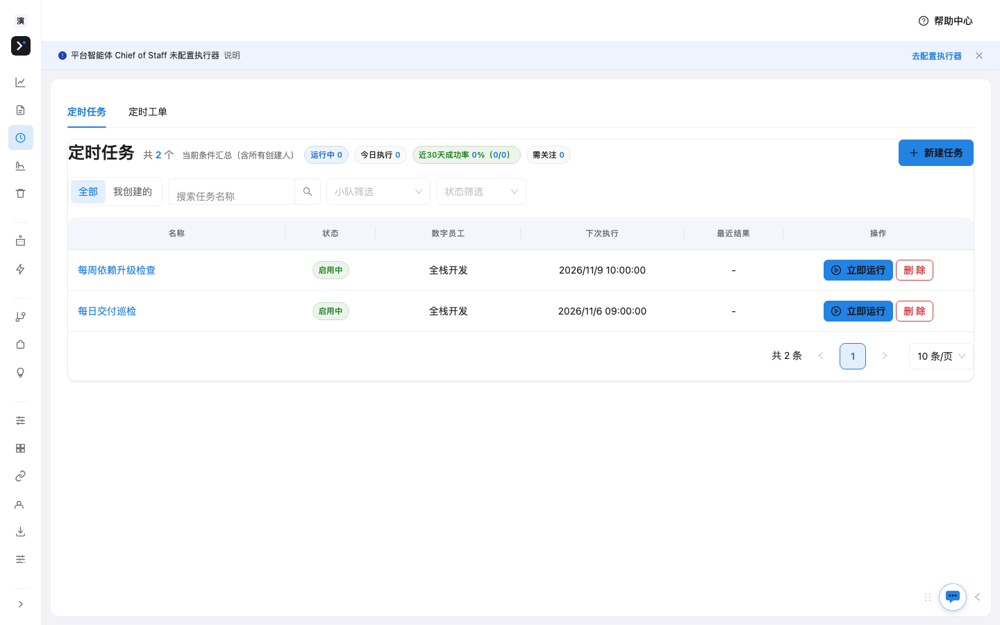

图29　定时任务

- **审计**:全部敏感操作留痕(谁、何时、对什么、做了什么),支持按操作类型过滤;

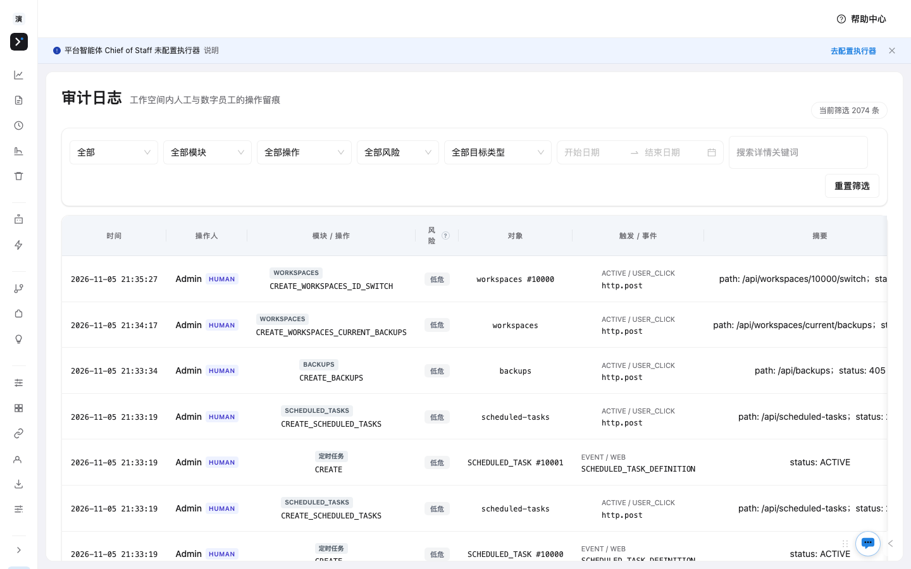

图30　审计日志

- **通知**:站内通知中心;**记忆**:平台记忆管理(数字员工长期记忆的查看与清理)。

---

## 17. 帮助中心

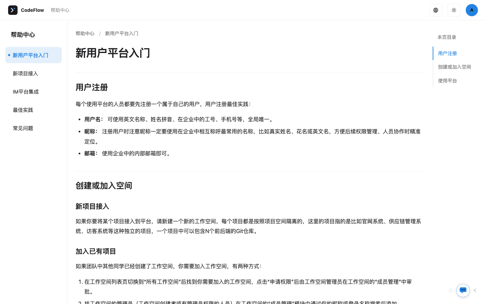

图31　帮助中心

- 顶部「帮助中心」直达;内容随版本内置,含分步图文与常见操作;
- 平台同时内置 `ainative` MCP 技能包(help/assets),供外部 CLI 客户端加载后获得平台操作指引。

---

## 18. 日常怎么用:推荐工作流

### 场景 A:禅道缺陷 → 数字员工修复 → 回写(全自动)

1. 管理员一次性完成 §11 的禅道绑定;
2. 之后禅道新 Bug 会在 ≤ 轮询间隔内自动出现在工单看板(带「来自 ZenTao」);
3. 给工单指派小队并启动交付——之后不需要人守着;
4. 有澄清问题会停在「待决策」,@ 回复即可;修复完成自动回写禅道。

### 场景 B:平台内需求 → 交付

1. 新建工单,把需求写清楚(或上传设计文档);
2. 启动交付,选小队;对不清楚的点先用澄清对话对齐;
3. 在交付进度跟踪里看执行,产物直接下载验收;
4. 验收不通过 → 评论返工意见 @数字员工,或重试派发。

### 场景 C:外部 CLI 里操作平台

1. 个人设置 → MCP 令牌 → 新建令牌,复制一次性完整 URL;
2. `claude mcp add --transport http ainative <url>`;
3. 在 Claude Code 里直接说"帮我建一个工单,标题是……"——AI 调平台 MCP 完成。

### 三条实践建议

- **需求写清验收标准**:数字员工按"完成门"自检,验收标准越明确返工越少;
- **别绕过平台改禅道状态**:状态机映射是双向的,手工错位会卡同步;
- **执行器保持常驻**:排队派发靠执行器上线自动唤醒,执行器越稳定交付越连贯。

---

## 19. 常见问题

**Q:派发一直"排队中"怎么办?**
看交付进度跟踪里的等待原因。`等待执行器上线` = 执行器没连上(去执行器页看在线状态、检查 daemon 是否存活、是否同 executorId 起了两个实例);`执行器容量已满` = 在跑的任务太多,等空闲或加执行器。排队有指数退避与上线自动唤醒,不需要手动重发。

**Q:数字员工交付失败了,先看什么?**
交付进度跟踪 → 失败派发 → 查看执行:日志里通常能看到是模型端点问题(配额/网络)、仓库权限问题还是步骤完成门未达标。修复后点「重试」。

**Q:禅道工单拉取了但没回写?**
检查三处:绑定是否启用、本地工单是否流转到了与禅道映射的完成类节点、时间线上回执事件的状态。回执失败会在时间线留痕并自动重试。

**Q:模型能换吗?**
能。执行器侧任意 Anthropic 兼容端点即可(Claude / MiniMax / GLM / Kimi / DeepSeek / 私有模型),改执行器 env 的 `ANTHROPIC_BASE_URL` / `ANTHROPIC_AUTH_TOKEN` / `ANTHROPIC_MODEL` 后重启 daemon。

**Q:MCP 完整令牌 URL 丢了?**
令牌只在创建时展示一次,丢了就吊销重建。列表里的"前缀"只用于辨认。

**Q:工单删错了?**
回收站恢复。外部来源(禅道)工单不可删,需回禅道处理。

---

## 20. 修订记录

| 版本 | 日期 | 说明 |
|---|---|---|
| v1.0 | 2026-11-04 | 首版:覆盖全部 28 个页面与关键交互,配图 30 张取自实机截图,UI 全量回归 31/31 通过。 |
| v1.1 | 2026-11-04 | 全量功能补齐:交付总览、执行记录、自进化、成员与角色三页签、项目备份、仓库关系图、AI 生成 SDLC、定时任务、首次使用引导;配图 32 张。 |
| v1.2 | 2026-11-06 | 开源基线:品牌更名 CodeFlow,截图全量重采集,新增首次使用引导章节。 |
